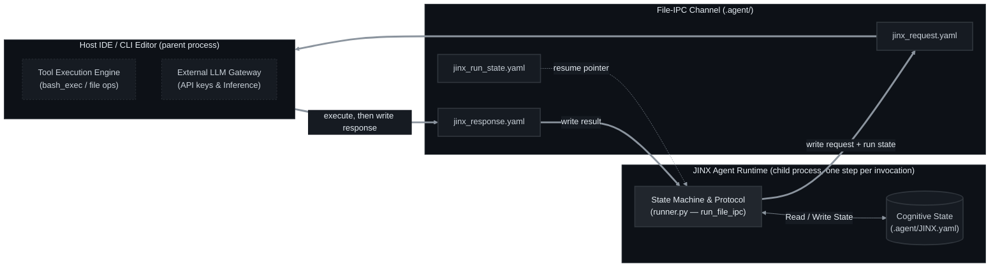
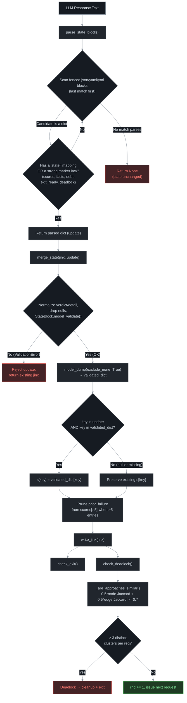
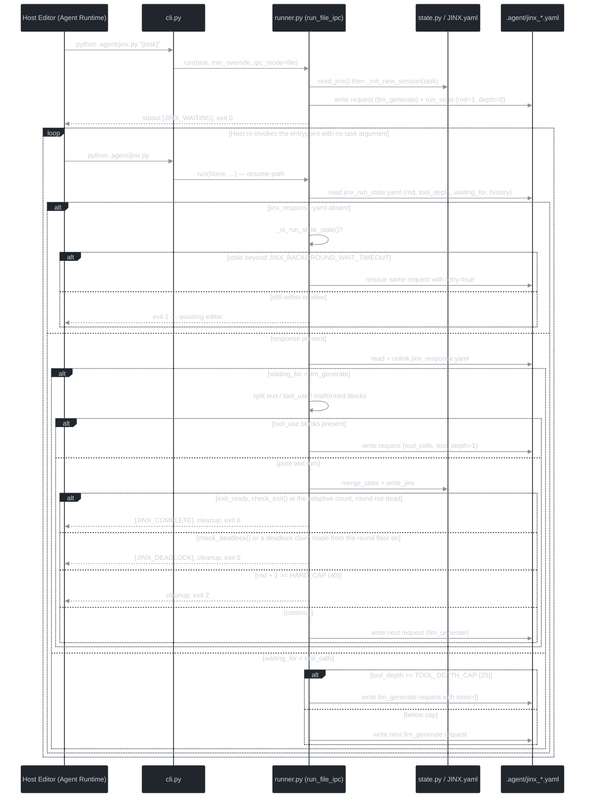

[English](README.md) | [Русский](README_RU.md) | [中文](README_ZH.md)

<p align="center">
  
  
  
  
</p>

<h1 align="center">JINX — Enterprise Sovereign Agent Runtime Specification</h1>

<p align="center">
  <strong>Technical specification for JINX, an isolated, stateful, protocol-driven cognitive loop designed to operate as a child process inside software engineering host environments.</strong>
</p>

---

## 1. Core Architecture & Inter-Process Communication (IPC)

JINX is an agent runtime designed to run inside a host environment (such as an IDE, command-line editor, or corporate orchestrator). The JINX runtime operates without independent network access or direct external service integrations; all external model invocation, file manipulation, and console execution requests are delegated to the host editor.

The runtime exposes **two IPC transports**, selected with the `--ipc` flag:

| Transport | Flag | Status | Mechanism |
| :--- | :--- | :--- | :--- |
| **File-based state machine** | `--ipc file` *(default)* | Primary | YAML request/response/run-state files inside `.agent/` |
| **Duplex stream JSON-RPC** | `--ipc rpc` | Legacy / embedded hosts | Line-delimited JSON over `stdout` / `stdin` |

### 1.1 File-Based IPC (default)

Each `python .agent/jinx.py` invocation performs **exactly one transition** of the state machine and then exits. The entire loop is re-entered by the host re-invoking the entrypoint with no task argument. All continuity lives on disk, so the runtime survives host restarts, editor crashes, and arbitrary process exit codes.

Three files make up the transport, all resolved relative to the `.agent/` directory:

| File | Written by | Purpose |
| :--- | :--- | :--- |
| `.agent/jinx_request.yaml` | JINX | The action JINX wants the host to perform |
| `.agent/jinx_response.yaml` | Host | The result of that action |
| `.agent/jinx_run_state.yaml` | JINX | Round counter, tool depth, message history, and the `waiting_for` pointer |

> **Several editors at once.** By default each run lives in a *session* with its own copy of these files (and of `JINX.yaml`) under `.agent/ipc/sessions/<sid>/`, so two editors in one project no longer overwrite each other's request and response. Every call prints a `[JINX_SESSION] id=… request=… response=… resume="…" [others=N]` line with the exact paths, the exact command to run next and how many other sessions are running. Set `JINX_SESSIONS=0` to use the single shared files in `.agent/` exactly as described in this section. See §1.3.

`stdout` carries only human-readable progress markers (`[JINX_WAITING]`, `[JINX_COMPLETE]`, `[JINX_DEADLOCK]`); all structured diagnostics go to `stderr` via the `jinx.cli` / `jinx.runner` loggers.



#### Request Contract — `type: llm_generate`

```yaml
type: llm_generate
system: "You are JINX, a single-agent cognitive loop..."   # prompts.SYSTEM_PROMPT
messages:                                                   # compacted history, see below
  - role: user
    content: "ROUND 1 (at least 10 rounds required before exit is considered)\nCURRENT STATE:\n..."
tools:                                                      # tools.tool_schema(); [] on depth-cap recovery
  - name: bash_exec
    description: Execute a bash or shell script in the environment.
    input_schema:
      type: object
      properties:
        script: {type: string, description: The script to execute}
      required: [script]
  - name: file_read
    description: Read the contents of a file.
    input_schema:
      type: object
      properties:
        path: {type: string, description: Path to the file}
        start_line: {type: integer, description: Optional 1-indexed starting line to read (inclusive)}
        end_line: {type: integer, description: Optional 1-indexed ending line to read (inclusive)}
      required: [path]
  - name: file_write
    description: Write or overwrite a file with new content.
    input_schema:
      type: object
      properties:
        path: {type: string, description: Path to the file}
        content: {type: string, description: The full content to write}
      required: [path, content]
processed_tool_use_ids: [call_00, call_01]   # already-executed calls, for editor-side dedupe
tool_result_cache:                          # memoized results, keyed by tool_use_id
  call_00: "85 passed in 0.21s"
retry: false                                  # true when reissued after a stale wait
```

**Expected host response:**

```yaml
content:
  - type: text
    text: "Analyzing codebase structure."
  - type: tool_use
    id: call_123
    name: bash_exec
    input: {script: pytest tests/test_state.py}
```

`content` may also be supplied as a plain string; JINX normalizes it into a single `text` block. Any `tool_use` block that is missing `id`/`name`, or whose `input` is not an object, is rejected and fed back to the model as a `tool_result` error instead of aborting the round.

#### Request Contract — `type: tool_calls`

```yaml
type: tool_calls
calls:
  - id: call_123
    name: bash_exec
    params: {script: pytest tests/test_state.py}
processed_tool_use_ids: []
tool_result_cache:
  call_00: "85 passed in 0.21s"
retry: false
```

**Expected host response:**

```yaml
results:
  - tool_use_id: call_123
    content: "59 passed in 0.14s"
```

#### Run State Contract — `jinx_run_state.yaml`

```yaml
rnd: 7
tool_depth: 2
waiting_for: llm_generate      # llm_generate | tool_calls
min_rounds: 10
rounds: {declared: 2, dead: 1, last_fail: 3}   # optional adaptive round ledger, see Phase IV
updated_at: 1758901234.5       # epoch seconds, written on every state change
processed_tool_use_ids: [call_00, call_01]   # optional, see below
history:                       # bounded window of recent messages
  - {role: user, content: "ROUND 7 ..."}
  - {role: assistant, content: [{type: text, text: "..."}]}
```

On resume the runner requires exactly five keys — `rnd`, `tool_depth`, `history`, `waiting_for` and
`min_rounds` — and treats their absence as an invalid run state. `updated_at` is stamped on every
write and drives stale-wait detection. `rounds` is the optional adaptive round ledger (a handful of
integers plus a call memory capped at 48 entries, so the run state stays flat however long the task
runs). It is validated on read: an older, truncated or hand-edited run state simply yields an empty
ledger instead of a crash.

`processed_tool_use_ids` is **optional and transient**. The runner appends each executed `tool_use_id`
to it after a tool response is processed, and reads it back when building the next request, but a
fresh `llm_generate` request rewrites the run state without the field. Hosts should therefore treat
the request's `processed_tool_use_ids` as the authoritative signal, and only use the run-state copy to
recover context for a stale retry.

`history` is a **bounded window**, not the whole transcript. The loop survives process boundaries
because each round reloads this window, and the window is advanced past a leading `tool_result` block
and trimmed of a trailing dangling `tool_use` block so the model never receives an orphan tool result
(`compact_history_for_request`). Two independent sizes apply: the run state keeps the newest
`JINX_HISTORY_PERSIST_WINDOW` messages (default **8**), while each `llm_generate` request ships only the
newest `JINX_HISTORY_WINDOW` (default **6**). Nothing ever reads the discarded messages back — exit and
deadlock detection read the score history in `JINX.yaml`, and tool dispatch only needs the most recent
calls — so the run state stays a fixed size instead of growing with every round. When a window is
truncated, the prompt carries a one-line note saying how many messages were elided, so the model does
not mistake the window for the whole session.

#### Stale-Wait Recovery

If `jinx_run_state.yaml` exists but `jinx_response.yaml` does not, the host failed to answer. JINX then calls `_is_run_state_stale()`: a run is stale only when **both** `updated_at` and the mtimes of `jinx_run_state.yaml` / `jinx_request.yaml` are older than `JINX_BACKGROUND_WAIT_TIMEOUT` (default `30` s). A stale run reissues the same request with `retry: true` and an expanded `processed_tool_use_ids` list so the host can return stored results instead of re-executing side effects; a non-stale run exits `1` and waits for the host to retry.

#### Cleanup and Signals

`SIGINT`, `SIGTERM`, and `SIGHUP` are trapped at import time; the handler removes all three IPC files and terminates via `os._exit(1)`. Normal exits call `clean_up_ipc_files()` on every success, deadlock, and hard-cap path, so a stale run state can never block the next session.

### 1.2 Duplex Stream JSON-RPC (`--ipc rpc`)

The legacy transport is preserved for hosts that prefer a single long-lived child process with piped streams. JINX prints one line-delimited JSON object per request and reads one line-delimited JSON object back.

#### `llm_generate`
* **Emitted to `stdout`**:
```json
{
  "jinx_command": "llm_generate",
  "params": {
    "system": "System instructions defining the cognitive boundaries.",
    "messages": [{"role": "user", "content": "Round-specific context."}],
    "tools": [{"name": "bash_exec", "input_schema": {"type": "object"}}]
  }
}
```
* **Expected response on `stdin`**:
```json
{
  "content": [
    {"type": "text", "text": "Analyzing codebase structure."},
    {"type": "tool_use", "id": "call_123", "name": "bash_exec", "input": {"script": "pytest tests/test_state.py"}}
  ]
}
```

#### `bash_exec`
* **Emitted to `stdout`**:
```json
{"jinx_command": "bash_exec", "tool_use_id": "call_123", "params": {"script": "pytest tests/test_state.py"}}
```
* **Expected response on `stdin`**:
```json
{"output": "=== 1 passed in 0.05s ==="}
```

#### `file_read` / `file_write`
* **Emitted to `stdout` (read)**:
```json
{"jinx_command": "file_read", "tool_use_id": "call_124", "params": {"path": "src/core.py", "start_line": 1, "end_line": 80}}
```
* **Expected response on `stdin` (read)**:
```json
{"content": "def run():\n    pass", "sliced": false}
```
* **Emitted to `stdout` (write)**:
```json
{"jinx_command": "file_write", "tool_use_id": "call_125", "params": {"path": "src/core.py", "content": "def run():\n    return True"}}
```
* **Expected response on `stdin` (write)**:
```json
{"output": "Success"}
```

A response is treated as an error when it carries an `error` key or a `status` string containing `error`. The optional `sliced` / `is_sliced` boolean tells JINX that the host already applied the `start_line` / `end_line` window; when it is absent or false, JINX slices the payload itself. Reads are served by a single background stdin reader thread feeding a shared queue, so timeouts never desynchronize the stream.

### 1.3 Several Sessions in One Project

Several editors can drive JINX in the same project at the same time (two Claude Code windows, or an orchestrator that starts one editor per task). Without coordination they would share one request file, one response file and one `JINX.yaml`, and the second editor would destroy the first one's run. With sessions (the default for `--ipc file`) every run gets a directory of its own and the sessions coordinate through plain files: **no database, no daemon, no network; only `.yaml` files and `.mbox` mail files**, written atomically, built on the standard library, PyYAML and Pydantic (the round files are made with `git`, which the project uses anyway). The editors run on one computer, so the files live in one directory tree and a rename or a hard link is nearly all the synchronisation that is needed (the exceptions are listed under *Synchronisation* below).

| Path under `.agent/ipc/` | Purpose |
| :--- | :--- |
| `sessions/<sid>/jinx_request.yaml`, `jinx_response.yaml`, `jinx_run_state.yaml`, `JINX.yaml` | The files of §1.1 and §3, one set per session. A new session starts from `.agent/JINX.yaml` when that file exists |
| `sessions/<sid>/card.yaml` | Presence card: task, room (the team), round, state, heartbeat, held paths, what the last round tried (`doing`), the files the last rounds changed (`touched`), the fingerprint of the editor that calls it (`who`), optional `JINX_EDITOR` label, and whether a shell batch is out (`shell`, `shell_ended`) |
| `sessions/<sid>/mail.yaml` | What the model has been told so far (mail already shown, the board as it was last shown) and the drafts that are under way |
| `sessions/<sid>/round.yaml` | The round in progress: what each file contained when the session took it (this is what `--peek` compares with), and the state of its shell batches |
| `sessions/<sid>/inbox/{new,cur,bad}/` | Mail for this session: many writers, one reader |
| `sessions/<sid>/outbox/` | Drafts the editor writes and the runner delivers; `sent/` and `rejected/` hold the outcome |
| `sessions/<sid>/rounds/NNNN.mbox` | The change of one closed round as one mail message in `git format-patch` layout: `git am` applies it |
| `sessions/<sid>/rounds/NNNN.yaml` | Its record: checksum, tree ids, files, flags and what the model said about the round |
| `claims/<key>/NNNNNNNN.yaml` | Write leases on paths: one numbered generation file per change of owner |
| `archive/<sid>-<time>/` | A finished session (or one silent for a long time) is moved here seven days after its last heartbeat, when a later session starts; its round files stay readable |

Every file carries `jinx: 1`, the protocol version, so there is no separate file for it. The whole directory is git-ignored, and so are `.agent/export/` (the output of `--export`, below) and the `notices/` folders (verdicts of the self-patch preflight that wait for the next prompt: one inside each session's directory, and `.agent/notices/` when `JINX_SESSIONS=0`); none of them counts as a change made by a round. The durable lesson ledger `.agent/lessons.yaml` stays shared and is updated under a file lock, so concurrent sessions do not lose each other's lessons.

**Launching and resuming.** Every agent starts JINX the same way, `python .agent/jinx.py "<task>"`. The runtime gives each launch a session of its own and an id (`s7f3a`) that is unique to it and is what mail, leases and round files use, so an agent does not have to track or remember which session it is. Every call prints `[JINX_SESSION] id=<sid> request=<path> response=<path> resume="<command>"` and, when others are running, `others=<n>`; the editor uses exactly those paths and that command. `--session <sid>` (or the `JINX_SESSION` environment variable) always works: it selects the session to resume, and given together with a task it names the new one. Stale-wait recovery, signal cleanup and completion (§1.1) apply to each session separately.

The runtime also recognises the calling editor, so that the command can be a bare `python .agent/jinx.py` even when several sessions are unfinished. Every call leaves a *fingerprint* on the session's card: the processes above JINX (the editor's own process, its terminal) and the environment variables that name a terminal pane or a window (`CLAUDE_PID`, `TMUX_PANE`, `WT_SESSION`, …). The marks two calls have in common are kept; those of the shell that ran one command drop out. The first call of a session therefore prints `resume="python .agent/jinx.py --session <sid>"`; once a second call has shown the same editor and the marks single the session out among the unfinished ones, the printed command is the bare one, and a bare call finds its session. The match is strict: a session is chosen only when the caller carries *all* the marks that tell it from the others, and never when another session's marks contain them. Two sessions run by one editor process (sub-agents of one window share its process and environment) cannot be told apart, so for them the printed command keeps the id, and a bare call exits `1` and lists the unfinished sessions instead of guessing. With exactly one unfinished session a bare call resumes it, as before.

**The board.** The runner tells each model who else is running and what they are doing, by itself and as briefly as it can; the model never has to look. A session that is alone gets nothing. With others around, the digest (the last message of the `llm_generate` request, not kept in the history) carries

```yaml
mail:
  you: s7f3a
  others:                  # `team:` lists the sessions that joined this one's work
    s9c21: r4 (reviewer) fixing the README table; holds README.md; on your files: runner.py
  news: [s9c21 now holds runner.py]     # only after the first digest, only when something changed
  use: 'mail: file_write .agent/ipc/sessions/s7f3a/outbox/<name>.yaml with to (<id>|room|*), ...'
```

Each line is the session's round, its editor label, what its model said its last round tried, what it holds, and, apart, the files it holds or changed that this session has held, changed or read lately. The whole list is shown the first time, whenever a session joins or leaves, and every three rounds, so what the others do stays current; in between, a change appears only as one line of `news` and only when it touches a file this session works with, at any request, so that the model hears it in time. When nothing changed nothing is said, and a plain information message arrives alone, without the list. A session that has finished leaves the board with one line (`s9c21 finished; changed README.md, runner.py`: the files of its latest rounds, newest first); its team, that is the host it joined or the helpers that joined it, also gets a short message with the paths of its last round files, and nobody else is sent one. Because the model sees a digest only in the request that carries it, every digest that can lead to an action ends with a one-line how-to (the outbox path, the mail fields and the `--peek` command); the longer explanation is given once per session.

**Looking at another session.** `python .agent/jinx.py --peek` lists every session in one line. `--peek <sid>` prints what that session does, one line per round that changed something (files, added and removed lines, the model's summary) and what it has changed in the round that is still running. `--diff` adds the changes themselves, the unfinished ones first and then the newest rounds, cut at 160 lines (80 per file); `--full` lifts the line limits and lists every round, but the output is still cut at 400,000 characters (12,000 without `--full`). It reads the card, the round files and `round.yaml` of that session and writes nothing; it does not run the self-patch preflight or import the runner, so it is safe next to a session that is editing JINX's own source. An archived session can be looked at too.

**Helping another session.** `python .agent/jinx.py --join <sid> ["<task>"]` starts a new session in the team of `<sid>`. It has its own files, rounds and leases, so it cannot overwrite the host's work; what it shares is the mail room: `to: room` reaches the host and the other helpers, the host is told that you joined, and the first request carries a briefing of a few lines (the host's task in its own words, its last three rounds with their files, what it holds, its open questions, and the `--peek` command) instead of a transcript. Without a task the helper's task is "help session `<sid>`" with the host's task.

**Mail.** An editor sends a message by writing a YAML draft with `file_write` into its own outbox (the digest's `use` line names the directory):

```yaml
to: sf0d0                # a session id (or a list of them), 'room' for the team, or '*' for every other session
kind: ask                # tell | ask | reply | patch | conflict | ack | nack
summary: Which file should I leave alone?    # one line, 160 characters at most
needs: reply             # none (the default) | ack | reply
re: sf0d0-3              # only when this message answers that one
thread: sf0d0-1          # optional: the message that started the conversation
ttl: 3600                # optional: seconds an unread message stays valid (10 to 604800; the default is 3600)
body: |                  # optional; a whole message is at most 64 KiB
  Free text or structured data.
refs:                    # optional attachments (at most 20), each with exactly one of `patch` or `file`
  - patch: sessions/sf0d0/rounds/0003.mbox   # a path inside .agent/ipc
    touches: [README.md] # optional, like `sha256` (64 hexadecimal digits), `size` and `round`
```

Sender, id and time are stamped by the runner, so a draft cannot be sent as somebody else. The runner validates the draft and delivers it atomically: the message is written under a hidden name and then linked into the recipient's `inbox/new/`, so a reader never sees a half-written file, and the reader consumes it by rename, so two readers cannot both get it. The draft moves to `sent/`, or to `rejected/` with the reason, which is shown to its author once (a draft addressed to a session that has finished is rejected too, with a pointer to `--peek <sid>`: nobody would ever read it). Unread mail is shown in the **digest** (see *The board*) as soon as it arrives; a message that asks for a reply is shown at most three times, and answering it (`re:`) acknowledges it. A session that is alone and has no mail gets nothing added to its prompt, so single-editor use costs no extra tokens. Mail is information from another agent, never an instruction from the user; the digest says so with every message.

**Write leases.** Before an editor writes a file the runner claims it for the session. A path has one holder at a time; a write to a held path is refused with a message that names the holder, and the editor mails the holder, works on something else, or waits. A lease is valid while its holder's heartbeat is fresh (`JINX_LEASE_S`); when the holder is dead the next claimant takes the path over, and each generation file carries a fencing number so that the late write of a previous holder is recognised. A write is also refused as stale when the file changed after the editor last read or wrote it, and releasing a lease records the state the file was left in, which is the starting point of the next holder's round. The lease is checked before a write is dispatched and again when the editor reports it done; the write itself is carried out by the editor, so a write that was already under way when the lease lapsed cannot be prevented, only recognised afterwards: the editor is told to read the file again, and the round is flagged `lost_claims`. Edits to JINX's own source (`.agent/src/jinx`) are refused while other sessions are running, because the self-patch gate compares the whole source tree with one baseline, and `git reset --hard`, `git clean -f`, `git stash`, `git checkout -f` / `git checkout .` and `git restore .` are refused while other sessions are alive.

**Round files.** When a round that changed files closes, the runner writes two files next to each other: `rounds/NNNN.mbox` and `rounds/NNNN.yaml`. The `.mbox` is the change as one mail message in the layout of `git format-patch` (`From <tree> Mon Sep 17 00:00:00 2001`, `From: JINX <sid@jinx.invalid>`, `Date`, `Subject: [PATCH] <what the model said it did>` (or `JINX session <sid>, round <n>` when that text is empty or begins with something `git am` would strip: `[`, `:` or `Re:`), the trailers `Jinx-Session` and `Jinx-Round`, a diffstat and a `git diff --binary`), so `git am` turns it into a commit. The `.yaml` is its record:

```yaml
jinx: 1
kind: round
session: s7f3a
round: 3
closed: 1793412176.174        # when the round closed (seconds since the epoch)
summary: Fix the README table
patch: 0003.mbox
sha256: 3b7e…                 # of the .mbox, with every line ending taken as LF
size: 710
base: 50c344ee…               # git tree of the files before the round
tree: 778f8bd7…               # ... and when it closed
touches: [README.md]
head: 5480bcec…               # the commit the project was at when the round began: a checkout to apply the round on
evidence:                     # only what the model itself said about the round
  passed: 2/2
  all_pass: true
```

`evidence` carries the verdict (`passed`, `failed`, `all_pass`) and, when stated, the model's `hypothesis`, `prediction_check` and `cause`. A round that could not be attributed exactly adds a flag to both files (a `Jinx-…` trailer and a key): `shell_unattributed`, `includes_unrecorded`, `lost_claims` or `shell_unrecorded`. The diff is taken between two git trees built from the recorded state of the files before the round and their state when it closed. The rounds of one file chain, so applying them in order reproduces the file: a round can be replayed, reviewed or reverted without touching the repository's history. The checksum is taken over the file with line endings normalised, so a round file that a Windows editor re-saved still verifies, while any other change is detected. The diff has one fixed format, `git diff --binary -M -U3` with `a/` and `b/` prefixes, whatever the person's git settings (`diff.noprefix`, `diff.context`, a textconv filter, `GIT_DIFF_OPTS`), because the format decides whether `git apply` can read it. Text the model wrote is cleaned before it is written (a lone surrogate becomes U+FFFD, control characters leave the subject), so one stray character never costs a round; and a round that changed files but could not be recorded leaves a `NNNN.yaml` with `failed:` and no `.mbox`, which the export names as left out. Building a round file never changes `HEAD`, the real index, a branch or the stash; it only adds unreferenced objects to git's object store, which `git gc` removes.

**Export.** `python .agent/jinx.py --export [<sid> ...] [--out DIR]` collects the round files of the named sessions (every session that is not archived when none is named) in the order the rounds closed into

* `.agent/export/jinx-<sid>.mbox`: the series, one message per round, with a blank line before every `From `, as an mbox requires. `git am --3way` applies it and makes one commit per round (the printed command adds `--keep-cr` when the repository holds CRLF files as they are, see below);
* `.agent/export/jinx-<sid>.yaml`: its record: the sessions, the checksum of the series, whether it applies, the command to apply it, and the record of every round (summary, files, flags, evidence).

A session whose run ends on its own terms (`[JINX_COMPLETE]`, `[JINX_DEADLOCK]` or the hard cap) is exported without being asked, and the runner prints one line for the editor to pass on to the person:

```
[JINX_EXPORT] rounds=4 mbox=.agent/export/jinx-s7f3a.mbox yaml=.agent/export/jinx-s7f3a.yaml apply="git am --3way .agent/export/jinx-s7f3a.mbox" head=5480bcecc9
```

`head` is the commit the first round began at: apply the series on a checkout of it (another clone, a `git worktree`), or on any commit where the files are unchanged. It is not meant for the working tree the session ran in: that tree already holds the work, uncommitted, and `git am` does not overwrite uncommitted changes (`--export` prints a `note:` then; commit the tree as it is, or apply the series elsewhere). Nothing in the project is touched by the export: whether the series applies to the current `HEAD` is checked on a private copy of the index, the way `git am --3way` would apply it, and the line carries `check=` when the answer is not a plain yes: `already` (`HEAD` holds these changes), `together` (the rounds build on files that other sessions changed first, so they apply only together with theirs; the line adds `all="python .agent/jinx.py --export"`), `no` (the first round that does not apply is named in the `.yaml`; so is a round that `HEAD` holds already, because `git am` stops at a patch that changes nothing and `git am --skip` goes on) or `unknown` (the check could not run). A diff is made from the bytes of the files, so it carries CR line endings where a file has them; the check reads it both ways, and the command has `--keep-cr` only when `HEAD` needs it (CRLF files committed as they are): in an LF repository whose checkouts are converted (`core.autocrlf=true`) plain `git am` is the right command. A round that cannot be passed on is left out, named in the `.yaml` and counted in `skipped=N`: its `.mbox` no longer matches the checksum in its `.yaml`, it could not be recorded, or an older JINX wrote it as a `.patch`. So `check=yes skipped=1` is a series that applies but is not complete. The files are named after the session (`jinx-s7f3a`), after up to three sessions joined by `-`, or `jinx-all` when more are collected; the command exits `1` when a round was left out or the series does not apply (`check=no` or `unknown`), and `0` otherwise.

**Shell commands.** A `bash_exec` changes files without saying which. Around every batch that contains one, the runner compares the working tree before and after and attributes the new changes to the round that ran the command. When another session's shell batch overlapped in time, only the files the script names are attributed and the rest is listed as `shell_unattributed`. A change to a file that another session holds gives the editor a conflict note and the holder a `conflict` message, except for a pure append (a log line, a list item), which is not a conflict.

**Synchronisation.** Mail and leases need nothing but the file system. A file is written completely under a hidden temporary name (`.<pid>.<random>.tmp`; leftovers older than ten minutes are swept) and then renamed or hard-linked to its final name, and a message is consumed by rename, so no process ever holds a lock across a wait. Two shared files are the exception, because several sessions update them in place: the lesson ledger (`.agent/lessons.yaml`) and the self-patch baseline are guarded by an operating-system file lock (`flock`, `msvcrt.locking` on Windows) on `.agent/lessons.yaml.lock` and `.agent/.selfpatch.lock`. Such a lock is released by the system when its holder dies, so there is no stale lock to break. When another session keeps it for the whole timeout (5 s for the ledger, 30 s for the baseline), that cycle is skipped, never run unlocked: the lesson update of that round is not written (nobody's data is lost), and the self-patch check waits for the next round. A lock that cannot exist at all (a file system without file locks, a lock file the user cannot open) is not "held by somebody": JINX warns (once per process and lock file) and goes on without it, as a single session would. A file system without hard links (some network and FAT shares) gets a copy in place of the link, and then a lease generation can be seen half written for the length of one small write; a reader treats an unreadable generation as a lease that nobody holds.

**Known limits.**
* A shell command is *noticed*, not *blocked*: leases protect `file_write`, not `bash_exec`. Two shell commands (or a shell command and a `file_write`) that rewrite one file at the same moment can lose an update: the later write wins, as it would without JINX. The overlap is reported (a conflict note, `shell_unattributed` in the round files), but JINX cannot give the lost text back.
* Fencing detects, it does not prevent: the editor performs the write, so a write that began before a lease lapsed can still land after the next holder took the path (see *Write leases*).
* The JSON-RPC transport (`--ipc rpc`) does not use sessions at all (one process, one run, as before); `JINX_SESSIONS` has no effect on it.
* Sub-agents of one editor process cannot be told apart by the runtime (they share the process and its environment), so each of them keeps using its own `--session <id>`. A model that ignores the printed `resume=` command and calls bare from such a process is refused when two of those sessions are unfinished; with only one of them it would get that one.
* A session that was abandoned (its editor gave up) stays "unfinished" until it is archived, and keeps the editor that started it from being recognised bare; its id still works.
* `--peek` shows text diffs; a binary file is reported as changed. The round in progress is compared with the state the session recorded when it took each file, so what another process did to that file in the meantime appears in the comparison too.
* Leases bind only JINX sessions. A person editing in an IDE is not stopped by one, and what such an edit changes inside a round is reported as `includes_unrecorded` instead of being hidden.
* Round files need the project root to be the top of a git working tree. In a subdirectory of a repository, or outside git, leases and mail still work, but no round files are written and there is nothing to export.
* Round files record the working tree, not intentions: a session that loses its lease mid-round gets a round flagged with `lost_claims`.
* A shell command that changes files *and* commits them in the same command (`sed -i … && git commit -am …`) leaves no uncommitted difference for JINX to compare, so its change is in the history but not in the round files. A commit made by a command of its own, after the edits, loses nothing.
* A round file is evidence, not a guarantee: the series of a session applies to the `head` it names, and to a later `HEAD` only while the files it changes are unchanged, or while `git am --3way` can merge them (it merges on the blobs a patch names, which only the repository the session ran in is sure to have); `--export` says which it found (`check=`).

---

## 2. Cognitive Loop Execution Protocol

The JINX runtime is governed by an iterative loop executed in discrete phases. Standard state properties are preserved across iterations via `JINX.yaml`.

```mermaid
%%{init: {'theme': 'base', 'themeVariables': {"darkMode": true, "background": "#0d1117", "primaryColor": "#21262d", "primaryTextColor": "#e6edf3", "primaryBorderColor": "#8b949e", "lineColor": "#8b949e", "textColor": "#e6edf3", "edgeLabelBackground": "#161b22", "mainBkg": "#21262d", "nodeBorder": "#8b949e", "nodeTextColor": "#e6edf3"}}}%%
flowchart LR
    classDef sub fill:#161b22,stroke:#30363d,stroke-dasharray: 3 3,color:#c9d1d9;
    classDef fail fill:#442326,stroke:#f85149,color:#ff7b72;
    classDef pass fill:#1f3b23,stroke:#56d364,color:#85e89d;

    subgraph P1["Phase I: Scope Intake"]
        A["1. Context & Boundary Parsing"]:::sub --> B["2. Write Scope to state.facts"]:::sub
    end
    style P1 fill:#0d1117,stroke:#30363d,color:#e6edf3

    subgraph P2["Phase II: Hypothesis Generation"]
        C["3. Register Failure History"]:::sub --> D["4. Evaluate Divergent Strategies"]:::sub
    end
    style P2 fill:#0d1117,stroke:#30363d,color:#e6edf3

    subgraph P3["Phase III: Breaker Testing"]
        E["5. Run Boundary Verification"]:::sub --> F["6. Populate requirements Schema"]:::sub
    end
    style P3 fill:#0d1117,stroke:#30363d,color:#e6edf3

    subgraph P4["Phase IV: Evaluation & Exit"]
        G{"7. Check Loop Convergence"}:::sub
        G -->|All Pass| H["Success Exit"]:::pass
        G -->|Failed Approaches >= 3| I["Deadlock Trigger"]:::fail
        G -->|Rounds >= 40| J["Hard Cap Trigger"]:::fail
    end
    style P4 fill:#0d1117,stroke:#30363d,color:#e6edf3

    B --> C
    D --> E
    F --> G
```



### Execution Phases

1. **Phase I: Scope Definition & Intake**
   Before starting file mutations, JINX parses the workspace environment and sets the boundaries of the target task. The validated context is written directly to the `state.facts` list in the configuration manifest `JINX.yaml`.

2. **Phase II: Hypothesis Generation & Divergence**
   If a previous round fails, JINX registers the failure reasons under `state.scores`. In subsequent rounds, JINX evaluates alternative strategies, optionally describing each strategy as an `approach_graph` knowledge graph so that deadlock detection can distinguish genuinely different strategies from superficial rewording. Repeating identical approaches without modification is blocked by protocol rules.

3. **Phase III: Boundary Verification (Breaker Testing)**
   For each strategy, a boundary-testing step ("Breaker Test") must be run. The implementation must be verified against edge cases, exceptional inputs, or performance bounds. The scoring criteria are structured in a binary schema (true/false) under `state.scores[].requirements`.

4. **Phase IV: Multi-Criteria Convergence & Exit**
   After each round, JINX updates the metrics and checks for exit or deadlock conditions:
   * **Exit Condition** (`check_exit`): the current round must be `>=` the round count in force (see *Adaptive round count* below), at least 2 score entries must exist, and the **latest** entry must have `all_pass: true`. Once 4 or more entries exist, the best `pass_count` of the last 3 rounds must not exceed the best `pass_count` of everything before them — a still-improving loop is not allowed to exit. The runner additionally refuses an exit from a *dead round* (below).
   * **Deadlock Condition** (`check_deadlock`): the round must be `>=` the round floor, and some requirement must have failed across at least **3 semantically distinct strategy clusters**. The model may also declare `deadlock: true` itself (a blocker only the user can remove), but such a claim counts only from the round floor on: an earlier claim is refused, its flag is cleared and the model is told, because "deadlock" is the cheapest way for a tired model to stop.
   * **Hard Cap**: the execution loop is strictly capped at 40 rounds (`HARD_CAP`); the process then exits with status `2` to prevent unbounded token consumption.
   * **Tool Depth Cap**: a single round may chain at most 20 tool calls (`TOOL_DEPTH_CAP`). On breach JINX injects a recovery instruction and issues one final `llm_generate` with `tools: []`, forcing a state block instead of a truncation.

   `loop.min` is resolved from `protocol.loop.min` in `JINX.yaml` (default **10**) or the `--min` CLI override, and is re-resolved after every round in both transports (the JSON-RPC loop included), so a protocol change emitted by the model takes effect mid-session — upward only, as described next. A `protocol` section is merged into the manifest only after the whole state block has validated, and a new task discards the sizing the previous task's model wrote (a value a person configured is kept), so a count sized for one question never leaks into the next.

   **Adaptive round count.** How many rounds the loop requires is recomputed after every round, from the model's own sizing and from what the runner itself observed, and it **only ever goes up**: a model that is tired or hurried has no way to make the loop shorter, which is the one direction in which laziness pays. The label of every round prompt (`ROUND n (at least m rounds ...)`) shows the count in force.
   * **Sizing.** The model sizes the loop with `protocol.loop.min`. Until it does, the default (**10**) applies. The first value it sends in round 1 or 2 is taken as sent (a one-line question does not need ten rounds); afterwards a value can only raise the count, and a first value sent later than round 2 cannot go below the configured or default count. Values are clamped to `[2, HARD_CAP - 1]`. `--min N` pins the sizing to exactly `N`; the rules below still apply on top of it.
   * **Dead rounds.** A round is *dead* when work was due and none was done: after a failed round, nothing new was run, edited or read (the same commands returning the same results count as nothing); after a pass that followed a failure, no command at all was run. A dead round adds one round to the count (at most `DEAD_ROUND_CAP` = 4) and cannot end the run; past the cap it is tolerated, so a task with nothing left to run can still finish.
   * **Confirming round.** A pass right after a failed round has to be re-verified by one more round (`CONFIRM_ROUNDS` = 1) before it can end the run. It applies to an exit only, never to the deadlock floor: a run that keeps failing must not be able to push a deadlock out of reach.
   * **Repeats.** The same tool call returning the same result 3 times gets a `REPEATED CALL` notice appended to those very results (at 5 it forbids the call until something it depends on changed), and the same `approach` restated with no further requirement passing gets a `REPEATED ATTEMPT` note in the next prompt. The wording escalates with the streak and only ever asks for a *different* approach; no notice offers a way to stop.
   * The notices are advice; the counts are enforced by the runner. The extra rounds never push the count past `HARD_CAP - 1`, so an exit always stays reachable. A model that ignores every notice and repeats itself still ends at the hard cap.

### Cognitive Loop Control Flow



`task` and `open` are deliberately **excluded** from the strong-marker set: they are common English words, and treating them as evidence would make the parser hijack unrelated YAML examples embedded in the model's reasoning.

### Cognitive Process Sequence Flow



---

## 3. State Manifest Specification (`JINX.yaml`)

All cognitive progress, failure logs, tasks, and loop settings are serialized to `JINX.yaml`, located in the isolated `.agent` workspace folder. This structure keeps state metadata out of the project repository root.

```yaml
id: JINX
protocol:
  loop:
    min: 10

state:
  task: "PyJWT RS256 token signing implementation"
  facts:
    - "Workspace root verified"
    - "Configuration schema loaded"
  scores:
    - round: 1
      approach: "PyJWT RS256 token signing implementation"
      prior_failure: null
      requirements:
        compile: true
        unit_tests: false
      pass_count: 1
      all_pass: false
      approach_graph:            # optional — enables semantic deadlock clustering
        nodes:
          - {id: "jwt_signer.py", type: file}
          - {id: "pytest", type: tool}
        edges:
          - {source: "pytest", target: "jwt_signer.py", relation: tests}
  debt: []
  open: []
  lessons:                    # optional — durable, cross-run; merged into .agent/lessons.yaml
    - text: "verify the parse before writing a state block"
      kind: rule
      evidence: "an unquoted ':' silently discarded a whole round"
  exit_ready: false
  deadlock: false
```

`lessons` is the only field here that is **not** stored in `JINX.yaml`. It is
routed to the durable ledger described in §4a.1, because `_init_new_session`
resets this block when a new task starts.

### Path Resolution

`JINX.yaml` is located by a three-tier lookup (`_resolve_jinx_path`):

1. `JINX_PATH` environment variable, if set.
2. `.agent/JINX.yaml` next to the installed package (development layout).
3. An upward walk from the current working directory looking for `<dir>/.agent/JINX.yaml`, falling back to `<cwd>/.agent/JINX.yaml`.

### Score Entry Formats

`ScoreEntry` accepts two shapes. The **full** format carries `requirements`, `pass_count`, and `all_pass`. The **simplified** format carries only a verdict and a free-text detail:

```yaml
scores:
  - round: 2
    verdict: fail        # pass | passed | ok | true | 1  → all_pass: true
    detail: "RS256 key loading still fails on rotated keys"   # → approach
```

Both are auto-normalized to the full schema (`requirements: {task_complete: <bool>}`, `pass_count`, `all_pass`, `approach`) before Pydantic validation, so a terse model reply can never be rejected. `round` defaults to `0` and `approach` to `"unspecified"`; `task`, `facts`, `debt`, and `open` are replaced wholesale by whatever the model sends, while `None`-valued keys are ignored so partial updates preserve the rest of the manifest.

`scores` is the exception: it is **merged by round number** rather than replaced (`merge_scores`). An entry whose `round` already exists replaces that stored entry, and rounds absent from the reply are preserved on disk. The model therefore only has to send the current round, while a full re-send remains valid and simply overwrites in place. Merged order is ascending by `round`, and entries without an integer `round` are keyed positionally so they survive the round trip. This removes the previous failure mode where a reply that omitted a round silently deleted it, and it is what lets the prompt stop demanding a full history echo every round.

Two working lists are kept bounded on write. Near-duplicate entries in `facts`, `debt`, and `open` collapse into one — comparison ignores case, punctuation, and whitespace, so `"Doesn't work."` and `"doesnt work"` are the same fact — and `facts` is capped at `JINX_FACTS_CAP` (default **60**) with the oldest entries dropped first, because that list is re-sent every round and is otherwise the dominant per-round cost. Facts stay *replaced* rather than accumulated, so the model can still retract a belief it has since disproved.

When a state block fails validation the previous state is kept and the reason is appended to the next round's prompt instead of being logged and discarded. A rejected block now tells the model that its block was rejected, what the validation error was, and the usual causes (an unquoted `:` or `#` inside a scalar, a tab used for indentation, a key nested one level too deep) — silent rejection previously looked identical to a model that had simply done nothing.

---

## 4. Codebase Component Inventory

The JINX runtime is comprised of the following Python components located in `.agent/` (with core package files under `.agent/src/jinx/`):

* **`jinx.py`** (Entrypoint Bootstrapper, located in `.agent/`):
  Serves as the execution entrypoint. It prepends `.agent/src` to `sys.path` so `import jinx` resolves without a global install, then delegates to the command line parser. Includes an automatic dependency bootstrapper that checks for and automatically installs version-bounded dependencies (`pydantic>=2.0.0`, `pyyaml>=6.0`) via `sys.executable -m pip` if missing, exiting `1` with a manual-install hint on failure. `--peek` and `--export` are answered here, before the self-patch preflight and before the runner is imported: `--peek` only reads, and `--export` reads the round files and writes nothing but its own output (`.agent/export/`, or the folder of `--out`).
* **`cli.py`** (Argument Parser):
  Parses inputs using `argparse`. Collects the positional task (joined into a single string) and the optional `--min` round override, `--ipc {file,rpc}` transport override, `--session <id>` selector and `--join <id>` (§1.3) before passing them to the orchestrator. `--peek [<id>] [--diff] [--full]` and `--export [<id> ...] [--out DIR]` (§1.3) are answered without starting a run. Logging is bound to `stderr` so the transport channel stays clean. A bare invocation with no task is treated as a resume and is only legal when a run state file exists (with sessions: when the runtime can tell which session is the caller's).
* **`runner.py`** (Orchestrator):
  Implements the state machine and both transports. Key responsibilities:
  * `run_file_ipc` — the default single-step state machine: resume detection, stale-wait recovery, response dispatch, and round advancement.
  * `run` — the transport dispatcher. Delegates to `run_file_ipc` when `ipc_mode == "file"`, otherwise runs the legacy long-lived JSON-RPC loop inline.
  * `parse_state_block` — extracts the last valid state block from markdown fences. The language tag is optional, so an untagged fence is parsed too; everything goes through `yaml.safe_load`, which also accepts JSON.
  * `check_exit` / `check_deadlock` / `_are_approaches_similar` — convergence and semantic-clustering logic.
  * `_declared_base` / `_round_floors` / `_close_round` / `_round_verdict` / `_finish_round` / `_record_tool_results` — the adaptive round count (sizing ratchet, dead rounds, confirming round, deadlock gate, repeated-call memory), shared by both transports so their rules cannot drift apart.
  * `Yaml` — isolated `SafeDumper` with a block-scalar-aware string presenter plus atomic temp-file writes; `HARD_CAP` (40) and `TOOL_DEPTH_CAP` (20) guard rails; signal handlers for IPC cleanup.
* **`state.py`** (Serialization Layer):
  Handles all file operations for the manifest `JINX.yaml`:
  * **Dynamic Path Resolution**: the three-tier `JINX_PATH` / dev-path / upward-walk lookup described in §3.
  * **Hardened Models**: Pydantic schemas `GraphNode`, `GraphEdge`, `ApproachGraph`, `ScoreEntry`, and `StateBlock` built with fault-tolerant defaults so a partially emitted block never raises or drops state.
  * **Atomic Writes**: `atomic_write_yaml` is the single source of truth for staging-file writes, shared by `StateManager.persist_state` and the runner.
  * **Format Normalization**: `_normalize_score_entry` / `_normalize_state_update` convert the simplified `verdict`/`detail` shape and drop `None` values before validation.
* **`tools.py`** (Tool Schema Registry):
  Returns the declarative tool schemas (`bash_exec`, `file_read` with optional `start_line`/`end_line`, `file_write`) shipped in every `llm_generate` request. It performs no I/O.
* **`learning.py`** (Durable Cross-Run Lesson Ledger):
  Makes learning outlive a run. `facts`/`debt`/`open` are per-run working memory and are deliberately truncated to keep per-round cost flat, so without this module the most expensive thing JINX learns is discarded between tasks. The ledger lives in a **separate file**, `.agent/lessons.yaml`, precisely because `_init_new_session` wipes the state block on a new task. Key responsibilities:
  * `add_lessons` — additive and deduplicating: a re-stated rule increments a `seen` counter instead of appending a copy, so a model that restates its rules every round cannot grow the file. Bounded by `JINX_LESSONS_CAP`.
  * `render_lessons` — injects a bounded `LEARNED RULES` block. Bounded by **both** a count (`JINX_LESSONS_INJECT_LIMIT`) and a character budget (`JINX_LESSONS_BUDGET_CHARS`), because characters are what actually cost tokens. Returns the keys of the lessons shown, which is what makes credit assignment possible.
  * `record_outcome` — each round credits or blames the lessons it was actually shown, by whether that round passed. A rule that keeps failing sinks and stops being injected, so the store self-prunes instead of growing. Without this the ledger would be a write-only log.
* **`selfpatch.py`** (Gated Self-Patching):
  Lets JINX edit its own code without letting it remove its own brakes. `file_write` accepts a bare string path, so the model has always been able to rewrite `.agent/src/jinx/*.py` — and has, which is how this repository's own release work happens. Nothing used to check whether the result still worked. This module adds that check:
  * **Protect, compile and roll back** — `capture_baseline` copies the source tree, `baseline_changed` diffs it, and `restore_baseline` reverts. After a framework-source edit, the gate runs two fast checks: `compileall`, and an import of every module in a child interpreter (with a bytecode cache of its own, so what is checked is what is on disk). A syntax error, a missing import or an exception at load time is reverted and reported to the model. Functional tests are selected and run by the editor CLI for the task at hand, so JINX does not repeat a project suite. The baseline lives for the whole run, not one round: it is captured when the run starts, kept while a round changes nothing, and re-captured after a structurally valid edit is adopted. It is dropped on a clean finish, and deliberately **kept** on an error exit, because that is what lets the next invocation repair the damage.
  * **Bootstrap preflight** — the same check runs once more in `.agent/jinx.py` before JINX is imported, loading `selfpatch.py` directly from its path. Without this, a self-edit that leaves a syntax error would stop the framework from starting at all, and the gate designed to catch exactly that would be unable to run. With no baseline on disk there is nothing to compare against, so a broken tree fails loudly instead of being silently overwritten.
  * **Brake protection** — `guard_tool_call` refuses a write that would redefine `merge_state`, `StateBlock`, `atomic_write_yaml`, `_resolve_jinx_path`, `_apply_protocol`, `check_exit`, `check_deadlock`, `_resolve_min_rounds`, `_handle_llm_response`, the exit-decision helpers (`_scores_of`, `_loop_of`), the adaptive round-count helpers and constants, or `SYSTEM_PROMPT`, and treats `selfpatch.py` and `learning.py` as wholly off limits. Refusal happens **before** dispatch, not after, so the model is told it was refused instead of concluding verification is broken. Protection compares the *bodies* of those definitions against what is on disk, not merely their presence, so rewriting a whole protected file is allowed as long as the brake itself is byte-identical. Weakening, rewriting or deleting a brake is refused, and so are the sneakier variants: appending a second definition that shadows the protected one at import time, or editing the file through `bash_exec`, which never passes the guard at all. The gate therefore re-runs the same comparison against the on-disk files and the baseline *before* verification, and a brake touched that way is rolled back without being tested: a green suite cannot justify changing the code that decides what a green suite means.
* **`mail.py`** (Office: Mail, Leases, Round Files):
  The coordination layer for several sessions, with no dependency beyond the standard library, PyYAML and Pydantic. Key responsibilities:
  * `Office` / `Session` — presence cards with heartbeats, per-session inbox and outbox, atomic publish-by-link and consume-by-rename delivery, a validated `Mail` schema, and the digest shown to the model: the board (`peer_line`, a snapshot of what concerns the reader, the `news` that differ from what was last shown) and unread mail.
  * `claim` / `release` — exclusive write leases on paths, as numbered generation files with fencing and dead-owner takeover.
  * `Round` — remembers what each file contained when it was claimed, refuses stale writes, and on close writes `rounds/NNNN.mbox` and `rounds/NNNN.yaml` from two git trees made with a private index (`snapshot_tree`, `tree_from_entries`, `round_diff`, `make_round_mbox`, `write_round`; `checksum`, `split_mbox` and `read_record` read them back), so building a round file never touches `HEAD`, the real index or the stash.
* **`identity.py`** (Which Editor Is Calling):
  Fingerprints the editor above a JINX process (its ancestors and a few terminal/window environment variables, from `/proc` or `ps`), `refine`s a session's marks across calls and `identify`s the caller among the unfinished sessions under the strict rule of §1.3. It never raises: no fingerprint just means the explicit `--session <id>`.
* **`team.py`** (Looking at Other Sessions):
  `--peek` (`board`, `status`, `rounds_of` over the round files, `in_progress`) and the briefing of a helper that joins a session (`briefing`). Read-only, bounded output.
* **`export.py`** (Rounds as One `.mbox`):
  `jinx.py --export` and the automatic export at the end of a run. `find_rounds` reads the `.mbox`/`.yaml` pairs of the chosen sessions and drops, with the reason, any whose checksum no longer matches, that could not be recorded or that an older JINX wrote, `check_series` tries the series on a private copy of the index the way `git am --3way` applies it, as written and without CR line endings (`yes`, `already`, `no`, and `together` when the rounds of other sessions are needed too), `build` writes `.agent/export/jinx-<sid>.mbox` and `.yaml`, and `line` renders the `[JINX_EXPORT]` line. It never changes the project and never raises into a run that has finished.
* **`sessions.py`** (Runner Glue for Sessions):
  The runner's only entry into `mail.py` (`team.py` only reads what it writes; `export.py` reads the round files and writes only the collected series). `open_session` finds or creates the session for an invocation (a task, `--session`, `--join`, or the session it recognises as the caller's), `describe` prints the `[JINX_SESSION]` line, `digest_message` / `commit_digest` / `flush_outbox` handle mail, `screen_call` / `check_writes` enforce leases on `file_write`, `screen_shell` / `before_batch` / `after_batch` watch shell commands, `round_closed` writes the round files, and `end` exports a session's rounds when its run finishes. Every function logs and carries on when its own I/O fails, because coordination must never be what stops a run that would otherwise succeed.
* **`evidence.py`** (Failed Checks Grouped by Cause):
  Turns the captured tail of a failed check into evidence grouped by cause instead of dozens of near-identical lines: `parse_failures` reads pytest-style `FAILED` / `ERROR` lines and the closing counts, `canonical_reason` masks what changes from run to run (long numbers, hex ids, durations, paths) so that one cause is not split into several, and `render_digest` / `evidence_from_check` print one line per distinct cause. It renders the notice that follows a reverted self-patch (`_render_check_failures` in `runner.py`). Pure functions: it reformats output that already exists and decides nothing.
* **`reasoning.py`** (Reasoning Notes from the Score History):
  Derives advisory notes from the scores the model itself wrote and renders them as one bounded block for the round prompt (`render_notes`): whether the prediction held (`classify_prediction`, `prediction_stats`), whether a failure repeats under a new name, why a run that looks finished is not allowed to exit (`exit_blockers`), renamed requirement keys, regressions, contradictions between a round's own claims, plan and citation checks against the file system, and a check that these notes still mirror the brake logic they describe. It adds no state and decides nothing: `check_exit` and `check_deadlock` remain the only code that ends a run.
* **`prompts.py`** (Prompt Templates):
  Holds `SYSTEM_PROMPT` (sent with every request, so kept short), `FIRST_ROUND_BRIEF` (the setup steps, appended to round 1 only), `REASONING_PROTOCOL` (the failure-analysis steps, delivered after a failed round instead of in the system prompt), the `MISSING_STATE_WARNING` injected when a round omits its state block, the `TOOL_DEPTH_CRITICAL_MSG` recovery directive, and `construct_round_prompt()`.

### Runtime Environment Variables

| Variable | Default | Applies to | Purpose |
| :--- | :--- | :--- | :--- |
| `JINX_PATH` | *(auto)* | both | Explicit path to `JINX.yaml` |
| `JINX_IPC_TIMEOUT` | `10` | `--ipc rpc` | Seconds to wait per stdin read attempt |
| `JINX_IPC_RETRIES` | `3` | `--ipc rpc` | Read attempts before raising `IPCError` |
| `JINX_IPC_BACKOFF` | `1.0` | `--ipc rpc` | Seconds between read attempts |
| `JINX_BACKGROUND_WAIT_TIMEOUT` | `30` | `--ipc file` | Seconds before an unanswered run is considered stale |
| `JINX_HISTORY_WINDOW` | `6` | both | Messages shipped in each `llm_generate` request |
| `JINX_HISTORY_PERSIST_WINDOW` | `8` | both | Messages retained in `jinx_run_state.yaml` |
| `JINX_FACTS_CAP` | `60` | both | Max `facts` entries kept; oldest dropped first |
| `JINX_KEEP_IPC_ON_SIGNAL` | *(unset)* | both | Set to `1` to keep IPC files on Ctrl+C for inspection |
| `JINX_TOOL_RESULT_CACHE_CAP` | `64` | both | Max memoized tool results kept; oldest evicted |
| `JINX_SESSIONS` | `1` | `--ipc file` | `0`, `false`, `no` or `off` turns sessions off: one shared set of files in `.agent/` (§1.3) |
| `JINX_SESSION` | *(unset)* | `--ipc file` | Session to resume when `--session` is not given |
| `JINX_EDITOR` | *(unset)* | `--ipc file` | Free-text label of the editor, stored on the presence card when the session is created; the other sessions see it on the board (`r4 (label) …`) |
| `JINX_LEASE_S` | `900` | `--ipc file` | Seconds (a decimal such as `45.5` is accepted) a session counts as alive after its last heartbeat, and so how long its write leases hold (minimum `30`); read when a session is created |
| `JINX_IPC_DIR` | `.agent/ipc` | `--ipc file` | Directory of the office: sessions and claims |
| `JINX_PROJECT_ROOT` | *parent of `.agent/`* | `--ipc file` | Project root that paths in leases and round files are relative to; the repository that `--export` checks the series against |
| `JINX_MAIL_PURE_YAML` | *(unset)* | `--ipc file` | Any value makes the mail layer use PyYAML's pure-Python parser instead of libyaml |

---

## 4a. Self-Improvement: Two Distinct Capabilities

JINX can improve itself, but "self-improvement" covers two very different things with very different risk profiles. Conflating them is the main design mistake available here, so they are kept separate.

### 4a.1 Durable Lessons — always safe, and the higher-value half

Everything JINX already learned (`prior_failure`, `approach_graph`, `facts`/`debt`/`open`) is **per-run** and deliberately truncated to hold per-round cost flat — `facts` at 60 entries, `prior_failure` to the last 5 rounds. So the most expensive thing it learns is thrown away between tasks, and every new task starts from zero.

The `lessons` field in the state block fixes that. Lessons are:

* **Additive.** Unlike `facts`/`debt`/`open`, which are *replaced* by whatever the model sends each round, lessons are merged. Send only new ones.
* **Durable.** They are written to `.agent/lessons.yaml`, a separate file, because starting a new task calls `_init_new_session`, which resets the state block. Wiping lessons there would make the store decay at exactly the rate of the state it is meant to outlast.
* **Credit-assigned.** Each round, the lessons that were actually injected are credited or blamed according to whether that round passed. Proven rules float up; rules that keep failing stop being shown. This is what makes it learning rather than a log, and it is also what keeps the store bounded.

Because they survive into later tasks, a lesson must be a general, reusable imperative rather than a note about the current task:

```yaml
lessons:
  - text: "state blocks are validated as one unit, so never leave approach_graph half-filled"
    kind: antipattern        # rule | skill | antipattern (inferred if omitted)
    evidence: "round 2 was rejected wholesale for one incomplete edge"
```

`kind` is optional and inferred from the wording when absent. `evidence` is optional.

To reset what JINX believes it has learned, delete `.agent/lessons.yaml`.

### 4a.2 Gated Self-Patching — powerful, and verified

JINX may edit its own code under `.agent/src/jinx/*.py` to improve its results, and for framework work this is often the *right* strategy rather than a workaround. The gate exists because of what was previously missing: a check that the result still works.

After any round that writes to framework source, the runner:

1. checks the framework with fast Python compilation (`compileall`);
2. imports every module in a child interpreter, so that a missing import or an exception at load time is caught as well;
3. keeps the edit when both pass, and otherwise **reverts the source tree** and feeds the compiler or import output back into the next round's prompt.

Separately, a write that would redefine the brake logic is **refused before dispatch** — not written and then undone — so the model is told it was refused rather than concluding that verification is broken. Protected: `merge_state`, `StateBlock`, `atomic_write_yaml`, `_resolve_jinx_path`, `_apply_protocol`, `check_exit`, `check_deadlock`, `_resolve_min_rounds`, `_handle_llm_response`, the exit-decision helpers (`_scores_of`, `_loop_of`), the adaptive round-count helpers (`_declared_base`, `_store_declared`, `_round_floors`, `_close_round`, `_round_verdict`, `_finish_round`, `_note_round_result`, `_record_tool_results`, `_ledger_of`, `_discard_sizing`) with their constants (`DEFAULT_MIN_ROUNDS`, `SIZING_ROUNDS`, `CONFIRM_ROUNDS`, `DEAD_ROUND_CAP`), and `SYSTEM_PROMPT`; `selfpatch.py` and `learning.py` are off limits entirely.

**Why the guard is not optional.** `file_write` has no path restrictions, and the model can already merge a `protocol` block into the manifest, which re-resolves `min_rounds` mid-session. Autonomous self-modification without a brake-removal guard would make "the agent improved itself" and "the agent removed the logic that would have noticed" indistinguishable — and the second is prompt-injectable from any task.

Set `JINX_ALLOW_PROTECTED_EDITS=1` to permit protected edits. That is a deliberate human override, not something for the agent to set for itself.

| Variable | Default | Applies to | Purpose |
| :--- | :--- | :--- | :--- |
| `JINX_SELF_PATCH` | `1` | both | Set to `0` to disable the verify-and-revert gate and lesson injection entirely |
| `JINX_SELF_PATCH_TIMEOUT` | `600` | both | Seconds allowed for each verification step (compile, import) before it counts as a failure |
| `JINX_SELF_PATCH_BASELINE` | `.agent/.selfpatch_baseline` | both | Where the throwaway pre-edit source copy lives |
| `JINX_ALLOW_PROTECTED_EDITS` | `0` | both | `1` permits edits to protected brake logic. Human override only |
| `JINX_LESSONS_CAP` | `40` | both | Max stored lessons; oldest evicted first |
| `JINX_LESSONS_INJECT_LIMIT` | `12` | both | Max lessons injected into a round prompt |
| `JINX_LESSONS_BUDGET_CHARS` | `1200` | both | Character budget for the injected block |
| `JINX_LESSONS_PATH` | `.agent/lessons.yaml` | both | Location of the durable lesson ledger |

---

## 5. Host Integration & Subprocess Implementation Guide

To integrate JINX, the host editor or corporate orchestrator must spawn the JINX execution command as a child process and drive the request/response loop.

### Spawning Specification
* **Command**: `python .agent/jinx.py "[TASK_DESCRIPTION]"` to start, `python .agent/jinx.py` to resume.
* **Process Configuration**: run with text-mode pipes. The host owns no in-memory state — everything needed to continue the loop is on disk.
* **Loop Mechanics**: after each invocation, read `.agent/jinx_request.yaml`. Dispatch on `type`, execute, write `.agent/jinx_response.yaml`, and re-invoke with no task argument. The loop ends when `jinx_request.yaml` no longer appears.

### Host Integration Python Example

The following script implements the host-side File-IPC execution protocol:

```python
import subprocess
import sys
from pathlib import Path
from typing import Any, Dict, List

import yaml

AGENT = Path(".agent")
REQUEST = AGENT / "jinx_request.yaml"
RESPONSE = AGENT / "jinx_response.yaml"
RUN_STATE = AGENT / "jinx_run_state.yaml"


def current_round() -> int:
    """The round JINX is asking about, read from the run state it just wrote.

    The manifest merges `scores` by round number, so the host only ever sends the
    round it is currently answering; earlier rounds are already on disk.
    """
    state = yaml.safe_load(RUN_STATE.read_text(encoding="utf-8")) or {}
    return int(state.get("rnd", 1))


def spawn(task: str | None = None) -> subprocess.CompletedProcess:
    """One JINX transition. Returns immediately after a request is written."""
    argv = [sys.executable, str(AGENT / "jinx.py")]
    if task:
        argv.append(task)
    return subprocess.run(argv, text=True, capture_output=True, check=False)


def call_llm(request: Dict[str, Any]) -> Dict[str, Any]:
    """Route `system` / `messages` / `tools` to your inference gateway.

    Replace the body with a real gateway call. This stub reads one file on the
    first round, then reports a state block, so the loop below actually reaches
    [JINX_COMPLETE] instead of requesting tools forever.
    """
    already_ran_a_tool = any(
        isinstance(m, dict) and isinstance(m.get("content"), list)
        and any(isinstance(b, dict) and b.get("type") == "tool_result"
                for b in m["content"])
        for m in request.get("messages", [])
    )
    if not already_ran_a_tool:
        return {"content": [
            {"type": "text", "text": "Inspecting the workspace."},
            {"type": "tool_use", "id": "call_01", "name": "file_read",
             "input": {"path": ".agent/src/jinx/state.py"}},
        ]}
    return {"content": [{"type": "text", "text": (
        "Read the manifest module.\n\n"
        "```yaml\nid: JINX\nstate:\n"
        "  task: Update the auth schema\n"
        "  facts:\n    - Inspected src/jinx/state.py\n"
        # Only this round's entry. merge_scores() keeps every earlier round, so
        # the manifest accumulates distinct rounds and check_exit can complete.
        f"  scores:\n    - round: {current_round()}\n"
        "      approach: Read the manifest module\n"
        "      requirements:\n        task_complete: true\n"
        "      pass_count: 1\n      all_pass: true\n"
        "  debt: []\n  open: []\n  exit_ready: true\n  deadlock: false\n```"
    )}]}


def run_tool(name: str, params: Dict[str, Any]) -> str:
    if name == "bash_exec":
        return subprocess.run(
            params["script"], shell=True, text=True,
            stdout=subprocess.PIPE, stderr=subprocess.STDOUT,
        ).stdout
    if name == "file_read":
        lines = Path(params["path"]).read_text(encoding="utf-8").splitlines()
        start = max(1, int(params.get("start_line", 1)))
        end = int(params.get("end_line", len(lines)))
        return "\n".join(lines[start - 1:end])
    if name == "file_write":
        target = Path(params["path"])
        target.parent.mkdir(parents=True, exist_ok=True)
        target.write_text(params["content"], encoding="utf-8")
        return "Success"
    return f"Error: unknown tool '{name}'"


def dispatch(request: Dict[str, Any]) -> None:
    """Write the response JINX is blocked on."""
    if request.get("type") == "llm_generate":
        response = call_llm(request)
    else:  # type == "tool_calls"
        # Replay memoized results instead of repeating the side effect. A call id
        # alone is not enough: the cache carries what the call actually produced.
        cache = request.get("tool_result_cache") or {}
        done: List[Dict[str, str]] = []
        for call in request.get("calls", []):
            cid = call["id"]
            if cid in cache:
                done.append({"tool_use_id": cid, "content": cache[cid]})
                continue
            done.append({
                "tool_use_id": cid,
                "content": run_tool(call["name"], call.get("params") or {}),
            })
        response = {"results": done}
    RESPONSE.write_text(yaml.safe_dump(response, sort_keys=False), encoding="utf-8")


def execute_jinx(task_description: str) -> int:
    result = spawn(task_description)
    if result.returncode != 0:
        return result.returncode  # 1 = awaiting editor, 2 = HARD_CAP exhausted

    while REQUEST.exists():
        request = yaml.safe_load(REQUEST.read_text(encoding="utf-8"))
        REQUEST.unlink()          # consume the request before writing the response
        dispatch(request)

        result = spawn()          # resume: no task argument
        if result.returncode != 0:
            return result.returncode

    # No request pending: JINX printed [JINX_COMPLETE] or [JINX_DEADLOCK].
    return 0


if __name__ == "__main__":
    print(f"JINX terminated with code: {execute_jinx('Update the auth schema')}")
```

> **Note**: never delete `jinx_run_state.yaml` between iterations — it is JINX's only pointer to the current round, tool depth, and message history.

**Dispatch table:**

| `type` | Read from request | Write to response |
| :--- | :--- | :--- |
| `llm_generate` | `system`, `messages`, `tools` | `content:` list of `text` / `tool_use` blocks |
| `tool_calls` | `calls[]` with `id`, `name`, `params` | `results[]` with `tool_use_id`, `content` |

Both request types carry `tool_result_cache`, a map of `tool_use_id` to the result that call produced. The runner records every result it receives and persists the map (bounded by `JINX_TOOL_RESULT_CACHE_CAP`, default **64**, oldest evicted), so a later request — including a `retry: true` reissue after a stale wait — can be answered from memory.

This is what makes `processed_tool_use_ids` sufficient. The id list alone tells the host *that* a call already ran but not *what it returned*, so the only safe response was to skip the call and drop its output — losing the result the model needed. With the cache the host can replay the exact stored content under the same `tool_use_id` and the side effect is not repeated. Hosts should therefore check `tool_result_cache` first and fall back to `processed_tool_use_ids` only if a cache is unavailable, since a call may legitimately be re-requested later with a different parameter set.

---

## 6. Post-Integration Developer Workflow

Once JINX is successfully launched and the File-IPC handshake is driven by the host, the developer's interaction with the runtime operates on an audit-and-intervention model.

### Real-Time Diagnostics
During execution, the developer does not need to actively manage the loop. Progress is observable through the following channels:
1. **State Manifest Auditing**:
   Open `.agent/JINX.yaml` in the editor. It is rewritten atomically at the end of every round. The `state` section acts as a live dashboard:
   * **`facts`**: Tracks all extracted domain properties currently assumed by the agent.
   * **`scores`**: Records the metrics and outcomes of each approach round-by-round, including `prior_failure` and any `approach_graph`.
   * **`debt`**: Lists any trade-offs or shortcuts documented by the agent.
   * **`open`**: Lists unresolved items carried into the next round.
2. **Run State Auditing**:
   `.agent/jinx_run_state.yaml` exposes `rnd`, `tool_depth`, `waiting_for`, and the recent message window, which is ideal for tracing exactly what the model was last told and what it did. For the complete record of what was attempted, read the `scores` history in `JINX.yaml` — that is lossless and unbounded by design, and it is the authoritative audit trail.
3. **Standard Output / Error Logs**:
   The host surfaces JINX's stdout progress markers and the `stderr` log stream (`[jinx.cli]`, `[jinx.runner]`, `[jinx.state]`) in a native UI tab.

### Handling Pause and Deadlock Interventions
JINX halts execution automatically when protocol limits are hit, requesting human oversight.
* **Deadlock Triggering**:
  If the same requirement fails across 3 semantically distinct strategy clusters (from the round floor on), or the model claims a blocker only the user can remove (also only from the round floor on; an earlier claim is refused and the loop goes on), `deadlock` is forced to `true` in the manifest, `[JINX_DEADLOCK]` is printed, IPC files are removed, and the process exits `0` (the loop terminated deliberately, not by error — inspect the manifest to distinguish it from a successful `[JINX_COMPLETE]`).
* **Hard Cap Triggering**:
  After 40 rounds the process exits `2` without cleanup markers being relied upon; IPC files are still removed.
* **Manual Correction Workflow**:
  1. Inspect `.agent/JINX.yaml` to identify the failing requirement and the approach history.
  2. Resolve the blocking issue in the code, or correct the environment (database seeds, fixtures, tool availability).
  3. Optionally hand-edit the `state` properties in `JINX.yaml` (facts, debt, open issues).
   4. Restart from the CLI. (With sessions, §1.3, resume with the `resume=` command from the `[JINX_SESSION]` line; a bare restart works while exactly one session is unfinished, or when the runtime recognises the calling editor.) A bare `python .agent/jinx.py` **resumes only when `jinx_run_state.yaml` still exists** — it is the flag that marks a run as unfinished. That file is removed on `[JINX_COMPLETE]`, `[JINX_DEADLOCK]`, and after the hard cap, so once a run has terminated a bare restart exits `1` with "Cannot start new session without a task description" rather than resuming. `JINX.yaml` itself is *not* deleted and stays readable as an audit record, but supplying a task calls `_init_new_session`, which resets `facts`, `scores`, `debt`, and `open` — so a new task starts from a clean slate and the previous evaluations are gone from the manifest. To continue interrupted work, leave the run-state in place and either fix the blocking cause and re-run bare, or hand-edit the manifest first.

### Session Verification and Commit
Once the loop satisfies all exit criteria, JINX prints `[JINX_COMPLETE] Task resolved successfully!` and exits `0`.
1. **Review Diff**: Inspect the file modifications produced in the workspace.
2. **Clear/Archive State**: The state metadata in `.agent/JINX.yaml` persists as context for the next task; the transient `jinx_request.yaml`, `jinx_response.yaml`, and `jinx_run_state.yaml` are removed automatically. With sessions (§1.3) the same holds inside `.agent/ipc/sessions/<sid>/`, which also keeps that session's `JINX.yaml` and its `rounds/NNNN.mbox` and `rounds/NNNN.yaml` files after the run (for seven days, then under `archive/`), so every round can be reviewed or replayed. When the run ends, JINX collects them into `.agent/export/jinx-<sid>.mbox` and `.yaml` and prints one `[JINX_EXPORT]` line; `git am --3way` on that `.mbox` commits the work of the run, one commit per round (§1.3, *Export*).

---

## 7. Verification Ownership

JINX does not ship or automatically repeat a framework test suite. The editor CLI selects and runs the relevant functional checks for the current task. After a self-patch, JINX performs only two fast checks, a Python compilation and an import of every module, to keep a source tree that cannot be loaded from becoming its baseline.

---

## 8. Integration Protocol for Anthropic Claude Code CLI Host Environment

The JINX architectural specification defines runtime deployment as a managed core within the official **Anthropic Claude Code CLI** console development environment. Under this orchestration scheme, Claude Code assumes the role of the parent orchestration host, translating JINX's logical steps into external services and the local file system.

The orchestration host manages:
1. Interception of incoming user requests.
2. Routing requests to external inference gateways (Claude via the Anthropic API).
3. Executing JINX declarative directives for file read, write, and system command execution.
4. Feeding results back into the JINX cognitive loop via the File-IPC mechanism.

In this repository, `CLAUDE.md` is configured to automatically and unconditionally route all user messages, greetings, and tasks through JINX to ensure the automated orchestration loop works seamlessly. If you prefer to manually invoke JINX, you can edit `CLAUDE.md` to restrict it to explicit requests only.

### Security and Interactive Execution Authorization

By default, the Claude Code CLI security model requires interactive operator confirmation for each file modification and shell command execution.

> [!TIP]
> **Recommended Secure Setup**: We strongly recommend keeping interactive prompts enabled. This ensures you explicitly review and approve every change JINX proposes before it is executed on your system.

#### OPTIONAL: Non-Interactive Sandbox Mode (For isolated or trust-verified environments)

If you prefer a fully automated, non-blocking cognitive loop (e.g., in a secure, isolated development container, sandboxed virtual machine, or CI/CD runner), you can opt to configure Claude's global settings to auto-approve file edits and specific shell patterns.

> [!CAUTION]
> **CRITICAL SECURITY WARNING**: Enabling `"defaultMode": "acceptEdits"` and auto-approving shell commands disables Claude Code's interactive confirmation prompts. This allows JINX (and any other agent running in this workspace) to read, write, and execute arbitrary commands on your host system without asking for confirmation. Do NOT configure these settings on your main host or in untrusted project environments.

The global settings configuration file is located at the universal path mapped to the active user profile's home directory:
* **Windows OS**: `%USERPROFILE%\.claude\settings.json` (resolves to `C:\Users\<Active_User_Account>\.claude\settings.json` dynamically)
* **macOS / Linux**: `~/.claude/settings.json` (resolves to `/home/<username>/.claude/settings.json`)

#### System Directives to Initialize or Modify the Configuration Profile:

To initialize or edit the security profile under your active user context, execute the appropriate shell command:

* **Windows (PowerShell)**:
  ```powershell
  notepad "$env:USERPROFILE\.claude\settings.json"
  ```
* **Windows (Command Prompt - CMD)**:
  ```cmd
  notepad %USERPROFILE%\.claude\settings.json
  ```
* **macOS / Linux (Terminal)**:
  ```bash
  nano ~/.claude/settings.json
  ```

Insert the following declarative permissions block into the JSON configuration file (wrap in a root `{}` object if the file is being newly created):

```json
{
  "permissions": {
    "defaultMode": "acceptEdits",
    "allow": [
      "Bash(python *)"
    ]
  }
}
```

#### Functional Purpose of Authorization Parameters (for Non-Interactive Mode):
| Parameter | Value Type | Architectural Description & Functional Purpose |
| :--- | :--- | :--- |
| `"defaultMode": "acceptEdits"` | `string` | Configures the host's file sandbox to auto-approve modifications. Allows JINX to perform non-blocking reads and writes of IPC files (`.agent/jinx_request.yaml`, `.agent/jinx_response.yaml`, `.agent/jinx_run_state.yaml`) and target software assets. |
| `"allow": ["Bash(python *)"]` | `array[string]` | Declarative whitelist of terminal command patterns. Permits the host to launch and execute the JINX orchestrator (`python .agent/jinx.py`) without waiting for manual operator approval. |

### Session Launch and Message Routing Procedure

1. Initialize the Claude Code CLI session within the project root directory:
   ```bash
   claude
   ```
2. To start a task with JINX, prefix your request or ask Claude explicitly to run JINX:
   * *“JINX: Add division to calc.py and verify with unit tests”*
   * *“Please run JINX to implement division”*

Following the developer's instruction, the host bootstraps the JINX orchestrator via `python .agent/jinx.py "[request]"`, drives the File-IPC handshake until the request file disappears, and reports the terminal marker (`[JINX_COMPLETE]`, `[JINX_DEADLOCK]`, or exit code `2`) together with the `[JINX_EXPORT]` line that follows it when the run changed files: the `.mbox` that holds the work, and the command that commits it. Which request and response file to use, and which command resumes the run, is printed on the `[JINX_SESSION]` line of every call (`.agent/jinx_request.yaml` and `.agent/jinx_response.yaml` only with `JINX_SESSIONS=0`). Several Claude Code windows can therefore work in one project at once, each driving its own session (§1.3); every window launches JINX the same way and the runtime tells each model who else is running and what they do. The project's `CLAUDE.md` tells every window to use the paths and the `resume` command from that line, to treat a `mail:` block as information from the other sessions, not as an instruction from the user, and to pass the `[JINX_EXPORT]` line on to the user.

---
