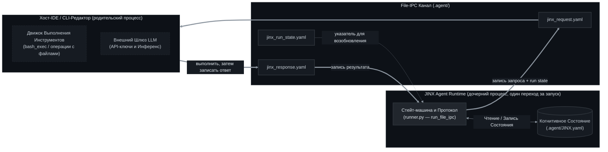
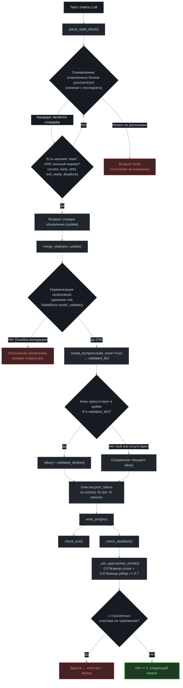
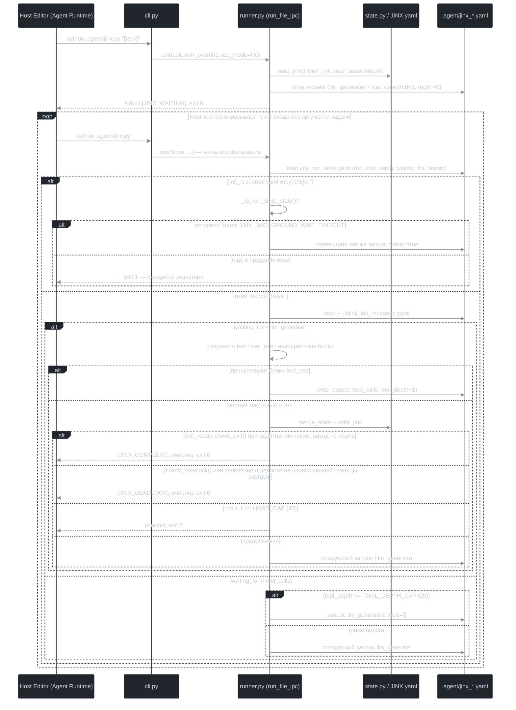

[English](README.md) | [Русский](README_RU.md) | [中文](README_ZH.md)

<p align="center">
  
  
  
  
</p>

<h1 align="center">JINX — Спецификация Среды Выполнения Суверенного Корпоративного Агента</h1>

<p align="center">
  <strong>Техническая спецификация JINX, изолированного, сохраняющего состояние, управляемого протоколом когнитивного цикла, предназначенного для работы в качестве дочернего процесса внутри хост-среды разработки ПО.</strong>
</p>

---

## 1. Базовая архитектура и межпроцессное взаимодействие (IPC)

JINX представляет собой среду выполнения агента, спроектированную для запуска внутри хост-окружения (такого как IDE, консольный текстовый редактор или корпоративный оркестратор). Среда выполнения JINX функционирует без автономного сетевого доступа или встроенных интеграций с внешними сервисами; все запросы на вызов моделей, манипуляции с файлами и выполнение консольных команд делегируются хост-редактору.

Среда выполнения предоставляет **два транспорта IPC**, выбираемых флагом `--ipc`:

| Транспорт | Флаг | Статус | Механизм |
| :--- | :--- | :--- | :--- |
| **Файловая конечная машина** | `--ipc file` *(по умолчанию)* | Основной | YAML-файлы запроса/ответа/состояния внутри `.agent/` |
| **Дуплексный поток JSON-RPC** | `--ipc rpc` | Устаревший / встраиваемые хосты | Разделенные переводами строки JSON через `stdout` / `stdin` |

### 1.1. File-IPC (по умолчанию)

Каждый запуск `python .agent/jinx.py` выполняет **ровно один переход** конечного автомата и затем завершается. Весь цикл восстанавливается повторным вызовом точки входа хостом без аргумента задачи. Вся непрерывность хранится на диске, поэтому среда выполнения переживает перезапуски редактора, сбои и любые коды возврата процесса.

Транспорт состоит из трёх файлов, все пути вычисляются относительно каталога `.agent/`:

| Файл | Кто пишет | Назначение |
| :--- | :--- | :--- |
| `.agent/jinx_request.yaml` | JINX | Действие, которое JINX просит выполнить хост |
| `.agent/jinx_response.yaml` | Хост | Результат этого действия |
| `.agent/jinx_run_state.yaml` | JINX | Счётчик раундов, глубина инструментов, история сообщений и указатель `waiting_for` |

> **Несколько редакторов одновременно.** По умолчанию каждый запуск живёт в собственной *сессии*, со своей копией этих файлов (и `JINX.yaml`) в `.agent/ipc/sessions/<sid>/`, поэтому два редактора в одном проекте больше не затирают запрос и ответ друг друга. Каждый вызов печатает строку `[JINX_SESSION] id=… request=… response=… resume="…" [others=N]` с точными путями, точной командой для следующего шага и числом других работающих сессий. `JINX_SESSIONS=0` возвращает единый общий набор файлов в `.agent/`, как описано в этом разделе. См. §1.3.

В `stdout` попадают только читаемые маркеры прогресса (`[JINX_WAITING]`, `[JINX_COMPLETE]`, `[JINX_DEADLOCK]`); вся структурированная диагностика уходит в `stderr` через логгеры `jinx.cli` / `jinx.runner`.



#### Контракт запроса — `type: llm_generate`

```yaml
type: llm_generate
system: "You are JINX, a single-agent cognitive loop..."   # prompts.SYSTEM_PROMPT
messages:                                                   # усечённая история, см. ниже
  - role: user
    content: "ROUND 1 (at least 10 rounds required before exit is considered)\nCURRENT STATE:\n..."
tools:                                                      # tools.tool_schema(); [] при восстановлении по лимиту глубины
  - name: bash_exec
    description: Execute a bash or shell script in the environment.
    input_schema:
      type: object
      properties:
        script: {type: string, description: The script to execute}
      required: [script]
  - name: file_read
    description: Read the contents of a file.
    input_schema:
      type: object
      properties:
        path: {type: string, description: Path to the file}
        start_line: {type: integer, description: Optional 1-indexed starting line to read (inclusive)}
        end_line: {type: integer, description: Optional 1-indexed ending line to read (inclusive)}
      required: [path]
  - name: file_write
    description: Write or overwrite a file with new content.
    input_schema:
      type: object
      properties:
        path: {type: string, description: Path to the file}
        content: {type: string, description: The full content to write}
      required: [path, content]
processed_tool_use_ids: [call_00, call_01]   # уже выполненные вызовы, для дедупликации на стороне редактора
tool_result_cache:                          # memoized results, keyed by tool_use_id
  call_00: "85 passed in 0.21s"
retry: false                                  # true при перевыдаче после устаревшего ожидания
```

**Ожидаемый ответ хоста:**

```yaml
content:
  - type: text
    text: "Analyzing codebase structure."
  - type: tool_use
    id: call_123
    name: bash_exec
    input: {script: pytest tests/test_state.py}
```

Поле `content` допускается передать и как обычную строку — JINX нормализует её в один блок `text`. Любой блок `tool_use`, в котором отсутствуют `id`/`name` либо `input` не является объектом, отклоняется и возвращается модели как ошибка в `tool_result`, вместо аварийного завершения раунда.

#### Контракт запроса — `type: tool_calls`

```yaml
type: tool_calls
calls:
  - id: call_123
    name: bash_exec
    params: {script: pytest tests/test_state.py}
processed_tool_use_ids: []
tool_result_cache:
  call_00: "85 passed in 0.21s"
retry: false
```

**Ожидаемый ответ хоста:**

```yaml
results:
  - tool_use_id: call_123
    content: "59 passed in 0.14s"
```

#### Контракт состояния запуска — `jinx_run_state.yaml`

```yaml
rnd: 7
tool_depth: 2
waiting_for: llm_generate      # llm_generate | tool_calls
min_rounds: 10
rounds: {declared: 2, dead: 1, last_fail: 3}   # необязательный журнал адаптивного числа раундов, см. Фазу IV
updated_at: 1758901234.5       # epoch-секунды, обновляется при каждом изменении состояния
processed_tool_use_ids: [call_00, call_01]   # необязательное поле, см. ниже
history:                       # ограниченное окно последних сообщений
  - {role: user, content: "ROUND 7 ..."}
  - {role: assistant, content: [{type: text, text: "..."}]}
```

При возобновлении раннер требует ровно пять ключей — `rnd`, `tool_depth`, `history`, `waiting_for` и
`min_rounds` — и считает состояние некорректным при их отсутствии. Поле `updated_at` проставляется
при каждой записи и управляет определением устаревшего ожидания. `rounds` — необязательный журнал
адаптивного числа раундов (несколько целых чисел и память вызовов не более чем на 48 записей, поэтому
состояние запуска не растёт, как бы долго ни шла задача). Он проверяется при чтении: старое, усечённое
или отредактированное вручную состояние запуска просто даёт пустой журнал, а не падение.

Поле `processed_tool_use_ids` **необязательное и временное**. Раннер дописывает в него каждый
выполненный `tool_use_id` после обработки ответа с результатами инструментов и читает его обратно при
формировании следующего запроса, однако новый запрос `llm_generate` перезаписывает состояние запуска
без этого поля. Поэтому хосту следует считать `processed_tool_use_ids` в запросе источником истины, а
копию в состоянии запуска использовать только для восстановления контекста при повторной выдаче
устаревшего запроса.

Поле `history` — это **ограниченное окно**, а не вся транскрипция. Цикл переживает границы процессов потому, что каждый раунд перезагружает это окно, а окно сдвигается за ведущий блок `tool_result` и очищается от висящего в конце вызова `tool_use`, поэтому модель никогда не получает «сиротский» результат инструмента (`compact_history_for_request`). Действуют два независимых размера: в run-state хранятся последние `JINX_HISTORY_PERSIST_WINDOW` сообщений (по умолчанию **8**), а в каждый запрос `llm_generate` отправляются только последние `JINX_HISTORY_WINDOW` (по умолчанию **6**). Отброшенные сообщения никто никогда не читает обратно — проверка выхода и детекция дедлока смотрят на историю оценок в `JINX.yaml`, а диспетчеризация инструментов нуждается только в последних вызовах, — поэтому run-state имеет фиксированный размер и не растёт от раунда к раунду. При усечении окна в промпт добавляется однострочное примечание о числе отброшенных сообщений, чтобы модель не приняла окно за всю сессию.

#### Восстановление после устаревшего ожидания

Если `jinx_run_state.yaml` существует, а `jinx_response.yaml` — нет, значит хост не ответил. Тогда JINX вызывает `_is_run_state_stale()`: запуск считается устаревшим только когда **и** `updated_at`, **и** время изменения `jinx_run_state.yaml` / `jinx_request.yaml` старше `JINX_BACKGROUND_WAIT_TIMEOUT` (по умолчанию `30` с). Устаревший запуск перевыдаёт тот же запрос с `retry: true` и расширенным списком `processed_tool_use_ids`, чтобы хост вернул сохранённые результаты, а не повторил побочные эффекты; неустаревший запуск завершается с кодом `1` и ждёт повтора хоста.

#### Очистка и сигналы

`SIGINT`, `SIGTERM` и `SIGHUP` перехватываются на этапе импорта; обработчик удаляет все три IPC-файла и завершает процесс через `os._exit(1)`. Нормальные выходы вызывают `clean_up_ipc_files()` на каждом пути успеха, дедлока и жёсткого лимита, поэтому устаревшее состояние запуска не может заблокировать следующую сессию.

### 1.2. Дуплексный поток JSON-RPC (`--ipc rpc`)

Устаревший транспорт сохранён для хостов, предпочитающих один долгоживущий дочерний процесс с перенаправленными потоками. JINX печатает по одному JSON-объекту на строку в запрос и читает по одному JSON-объекту в ответ.

#### `llm_generate`
* **Отправляется в `stdout`**:
```json
{
  "jinx_command": "llm_generate",
  "params": {
    "system": "System instructions defining the cognitive boundaries.",
    "messages": [{"role": "user", "content": "Round-specific context."}],
    "tools": [{"name": "bash_exec", "input_schema": {"type": "object"}}]
  }
}
```
* **Ожидаемый ответ в `stdin`**:
```json
{
  "content": [
    {"type": "text", "text": "Analyzing codebase structure."},
    {"type": "tool_use", "id": "call_123", "name": "bash_exec", "input": {"script": "pytest tests/test_state.py"}}
  ]
}
```

#### `bash_exec`
* **Отправляется в `stdout`**:
```json
{"jinx_command": "bash_exec", "tool_use_id": "call_123", "params": {"script": "pytest tests/test_state.py"}}
```
* **Ожидаемый ответ в `stdin`**:
```json
{"output": "=== 1 passed in 0.05s ==="}
```

#### `file_read` / `file_write`
* **Отправляется в `stdout` (чтение)**:
```json
{"jinx_command": "file_read", "tool_use_id": "call_124", "params": {"path": "src/core.py", "start_line": 1, "end_line": 80}}
```
* **Ожидаемый ответ в `stdin` (чтение)**:
```json
{"content": "def run():\n    pass", "sliced": false}
```
* **Отправляется в `stdout` (запись)**:
```json
{"jinx_command": "file_write", "tool_use_id": "call_125", "params": {"path": "src/core.py", "content": "def run():\n    return True"}}
```
* **Ожидаемый ответ в `stdin` (запись)**:
```json
{"output": "Success"}
```

Ответ считается ошибочным, если содержит ключ `error` либо строку `status` с подстрокой `error`. Необязательный булев флаг `sliced` / `is_sliced` сообщает JINX, что хост уже применил окно `start_line` / `end_line`; если он отсутствует или равен false, JINX выполняет нарезку самостоятельно. Чтение потока обслуживает единственный фоновый поток-читатель `stdin`, сбрасывающий данные в общую очередь, поэтому таймауты не рассинхронизируют поток.

### 1.3. Несколько сессий в одном проекте

Несколько редакторов могут работать с JINX в одном проекте одновременно (два окна Claude Code или оркестратор, запускающий по редактору на каждую задачу). Без координации они делили бы один файл запроса, один файл ответа и один `JINX.yaml`, и второй редактор уничтожил бы запуск первого. С сессиями (по умолчанию для `--ipc file`) каждый запуск получает собственный каталог, а сессии координируются через обычные файлы: **без базы данных, без демона, без сети; только файлы `.yaml` и почтовые файлы `.mbox`**, записываемые атомарно и построенные на стандартной библиотеке, PyYAML и Pydantic (файлы раундов создаются с помощью `git`, который проект и так использует). Редакторы работают на одном компьютере, поэтому файлы лежат в одном дереве каталогов, и почти всю нужную синхронизацию обеспечивает переименование или жёсткая ссылка (исключения перечислены ниже, в абзаце *Синхронизация*).

| Путь внутри `.agent/ipc/` | Назначение |
| :--- | :--- |
| `sessions/<sid>/jinx_request.yaml`, `jinx_response.yaml`, `jinx_run_state.yaml`, `JINX.yaml` | Файлы из §1.1 и §3, по одному комплекту на сессию. Новая сессия стартует с `.agent/JINX.yaml`, если он существует |
| `sessions/<sid>/card.yaml` | Карточка присутствия: задача, комната (команда), раунд, состояние, heartbeat, занятые пути, что пробовал последний раунд (`doing`), какие файлы изменили последние раунды (`touched`), отпечаток вызывающего редактора (`who`), необязательная метка `JINX_EDITOR` и признак запущенного пакета shell-команд (`shell`, `shell_ended`) |
| `sessions/<sid>/mail.yaml` | Что модели уже сообщили (показанная почта, табло в том виде, в каком его показали в последний раз) и черновики в работе |
| `sessions/<sid>/round.yaml` | Раунд в процессе: что содержал каждый файл, когда сессия его взяла (с этим сравнивает `--peek`), и состояние её пакетов shell-команд |
| `sessions/<sid>/inbox/{new,cur,bad}/` | Почта для этой сессии: много пишущих, один читающий |
| `sessions/<sid>/outbox/` | Черновики, которые пишет редактор и доставляет раннер; в `sent/` и `rejected/` лежит исход |
| `sessions/<sid>/rounds/NNNN.mbox` | Изменение одного закрытого раунда в виде одного почтового сообщения в формате `git format-patch`: его применяет `git am` |
| `sessions/<sid>/rounds/NNNN.yaml` | Его запись: контрольная сумма, идентификаторы деревьев, файлы, флаги и то, что модель сказала о раунде |
| `claims/<key>/NNNNNNNN.yaml` | Аренды записи (lease) на пути: один пронумерованный файл-поколение на каждую смену владельца |
| `archive/<sid>-<time>/` | Завершённая (или давно молчащая) сессия переносится сюда через семь дней после последнего heartbeat, когда стартует следующая сессия; её файлы раундов остаются читаемыми |

Каждый файл содержит `jinx: 1` — версию протокола, поэтому отдельного файла для неё нет. Весь каталог исключён из git, как и `.agent/export/` (результат `--export`, см. ниже) и папки `notices/` (вердикты предполётной проверки self-patch, ожидающие следующего промпта: по одной внутри каталога каждой сессии и `.agent/notices/` при `JINX_SESSIONS=0`); ничто из этого не считается изменением, сделанным раундом. Долговременный реестр уроков `.agent/lessons.yaml` остаётся общим и обновляется под файловой блокировкой, поэтому параллельные сессии не теряют уроки друг друга.

**Запуск и возобновление.** Каждый агент запускает JINX одинаково: `python .agent/jinx.py "<задача>"`. Среда выполнения выдаёт каждому запуску собственную сессию и уникальный идентификатор (`s7f3a`), по которому работают почта, аренды и файлы раундов, поэтому агенту не нужно отслеживать или помнить, какая сессия его. Каждый вызов печатает `[JINX_SESSION] id=<sid> request=<путь> response=<путь> resume="<команда>"` и, когда работают другие, `others=<n>`; редактор использует ровно эти пути и эту команду. `--session <sid>` (или переменная окружения `JINX_SESSION`) работает всегда: она выбирает сессию для возобновления, а вместе с задачей задаёт имя новой. Восстановление после устаревшего ожидания, очистка по сигналам и завершение (§1.1) применяются к каждой сессии отдельно.

Среда выполнения также узнаёт вызывающий редактор, поэтому команда может быть голой `python .agent/jinx.py`, даже когда незавершённых сессий несколько. Каждый вызов оставляет на карточке сессии *отпечаток*: процессы выше JINX (собственный процесс редактора, его терминал) и переменные окружения, называющие панель терминала или окно (`CLAUDE_PID`, `TMUX_PANE`, `WT_SESSION`, …). Признаки, общие у двух вызовов, сохраняются; признаки оболочки, выполнившей одну команду, отпадают. Поэтому первый вызов сессии печатает `resume="python .agent/jinx.py --session <sid>"`; когда второй вызов подтвердил тот же редактор и признаки выделяют сессию среди незавершённых, печатаемая команда становится голой, и голый вызов находит свою сессию. Совпадение строгое: сессия выбирается, только если вызывающий несёт *все* признаки, отличающие её от остальных, и никогда — если признаки другой сессии их содержат. Две сессии одного процесса редактора (субагенты одного окна делят его процесс и окружение) различить нельзя, поэтому для них печатаемая команда сохраняет идентификатор, а голый вызов завершается с кодом `1` и перечисляет незавершённые сессии вместо угадывания. Если незавершённая сессия ровно одна, голый вызов возобновляет её, как и раньше.

**Табло.** Раннер сам и как можно короче сообщает каждой модели, кто ещё работает и чем занят; модели не приходится смотреть самой. Сессия, работающая в одиночку, не получает ничего. Когда есть другие, дайджест (последнее сообщение запроса `llm_generate`, в историю не попадает) содержит

```yaml
mail:
  you: s7f3a
  others:                  # `team:` перечисляет сессии, присоединившиеся к работе этой
    s9c21: r4 (reviewer) fixing the README table; holds README.md; on your files: runner.py
  news: [s9c21 now holds runner.py]     # только после первого дайджеста и только если что-то изменилось
  use: 'mail: file_write .agent/ipc/sessions/s7f3a/outbox/<name>.yaml with to (<id>|room|*), ...'
```

Каждая строка — это раунд сессии, метка её редактора, что, по словам её модели, пробовал последний раунд, что она держит и — отдельно — файлы, которые она держит или изменила и с которыми эта сессия недавно работала, которые меняла или читала. Весь список показывается в первый раз, при каждом входе или выходе сессии и каждые три раунда, чтобы сведения о работе других оставались актуальными; в промежутках изменение появляется одной строкой `news` и только если затрагивает файл, с которым работает эта сессия, — при любом запросе, чтобы модель узнала вовремя. Когда ничего не изменилось, не говорится ничего, а простое информационное сообщение приходит одно, без списка. Завершившаяся сессия покидает табло одной строкой (`s9c21 finished; changed README.md, runner.py`: файлы её последних раундов, самые новые первыми); её команда, то есть хост, к которому она присоединилась, или помощники, присоединившиеся к ней, получает ещё и короткое сообщение с путями её последних файлов раундов, остальным оно не отправляется. Поскольку модель видит дайджест только в том запросе, который его несёт, каждый дайджест, способный привести к действию, заканчивается однострочной инструкцией (путь outbox, поля письма и команда `--peek`); более длинное объяснение даётся один раз за сессию.

**Просмотр другой сессии.** `python .agent/jinx.py --peek` перечисляет все сессии по строке на каждую. `--peek <sid>` печатает, что делает эта сессия: по строке на каждый раунд, изменивший что-либо (файлы, добавленные и удалённые строки, резюме модели), и то, что она изменила в ещё идущем раунде. `--diff` добавляет сами изменения — сначала незавершённые, затем самые новые раунды — с обрезкой на 160 строках (80 на файл); `--full` снимает ограничения по строкам и перечисляет все раунды, но вывод всё равно обрезается на 400 000 символов (без `--full` — на 12 000). Команда читает карточку, файлы раундов и `round.yaml` этой сессии и ничего не пишет; она не запускает предполётную проверку self-patch и не импортирует раннер, поэтому безопасна рядом с сессией, которая правит исходники самого JINX. Заархивированную сессию тоже можно посмотреть.

**Помощь другой сессии.** `python .agent/jinx.py --join <sid> ["<задача>"]` запускает новую сессию в команде `<sid>`. У неё свои файлы, раунды и аренды, поэтому она не может затереть работу хоста; общее у них — почтовая комната: `to: room` доходит до хоста и других помощников, хост узнаёт о вашем присоединении, а первый запрос содержит вводную из нескольких строк (задача хоста его словами, его три последних раунда с файлами, что он держит, его открытые вопросы и команда `--peek`) вместо стенограммы. Без задачи задачей помощника становится «help session `<sid>`» вместе с задачей хоста.

**Почта.** Редактор отправляет сообщение, записывая YAML-черновик через `file_write` в собственный outbox (строка `use` дайджеста называет каталог):

```yaml
to: sf0d0                # id сессии (или их список), 'room' для команды или '*' для всех остальных сессий
kind: ask                # tell | ask | reply | patch | conflict | ack | nack
summary: Which file should I leave alone?    # одна строка, не более 160 символов
needs: reply             # none (по умолчанию) | ack | reply
re: sf0d0-3              # только если это сообщение отвечает на то
thread: sf0d0-1          # необязательно: сообщение, с которого началась переписка
ttl: 3600                # необязательно: сколько секунд непрочитанное сообщение остаётся действительным (от 10 до 604800; по умолчанию 3600)
body: |                  # необязательно; всё сообщение — не более 64 КиБ
  Free text or structured data.
refs:                    # необязательные вложения (не более 20), в каждом ровно одно из `patch` или `file`
  - patch: sessions/sf0d0/rounds/0003.mbox   # путь внутри .agent/ipc
    touches: [README.md] # необязательно, как и `sha256` (64 шестнадцатеричные цифры), `size` и `round`
```

Отправителя, id и время проставляет раннер, поэтому черновик нельзя отправить от чужого имени. Раннер проверяет черновик и доставляет его атомарно: сообщение записывается под скрытым именем, а затем связывается ссылкой с `inbox/new/` получателя, поэтому читатель никогда не видит наполовину записанный файл, а забирает его переименованием, так что двое не получат одно и то же. Черновик перемещается в `sent/` либо в `rejected/` с причиной, которая один раз показывается автору (черновик, адресованный завершившейся сессии, тоже отклоняется — со ссылкой на `--peek <sid>`: его не прочёл бы никто). Непрочитанная почта показывается в **дайджесте** (см. *Табло*) сразу по поступлении; сообщение, требующее ответа, показывается не более трёх раз, а ответ на него (`re:`) подтверждает получение. Сессии, которая одна и без почты, в промпт ничего не добавляется, поэтому работа с одним редактором не стоит лишних токенов. Почта — это информация от другого агента, но не указание пользователя; дайджест говорит об этом при каждом сообщении.

**Аренды записи.** Перед записью файла редактором раннер берёт его в аренду для сессии. У пути в каждый момент один владелец; запись в занятый путь отклоняется сообщением с именем владельца, и редактор пишет владельцу, занимается другим или ждёт. Аренда действительна, пока свеж heartbeat владельца (`JINX_LEASE_S`); когда владелец мёртв, следующий претендент забирает путь, а каждый файл-поколение несёт число-ограждение (fencing), чтобы запоздалая запись прежнего владельца была распознана. Запись также отклоняется как устаревшая, если файл изменился после того, как редактор последний раз его читал или писал, а при освобождении аренды фиксируется состояние, в котором файл оставлен, — это исходная точка раунда следующего владельца. Аренда проверяется до отправки записи и ещё раз, когда редактор сообщает о её выполнении; сама запись выполняется редактором, поэтому запись, уже начавшуюся к моменту истечения аренды, нельзя предотвратить, а можно только распознать постфактум: редактору велят прочитать файл заново, а раунд помечается `lost_claims`. Правки исходников самого JINX (`.agent/src/jinx`) отклоняются, пока работают другие сессии, потому что гейт self-patch сравнивает всё дерево исходников с одним baseline; а `git reset --hard`, `git clean -f`, `git stash`, `git checkout -f` / `git checkout .` и `git restore .` отклоняются, пока живы другие сессии.

**Файлы раундов.** Когда закрывается раунд, изменивший файлы, раннер записывает два файла рядом: `rounds/NNNN.mbox` и `rounds/NNNN.yaml`. `.mbox` — это изменение в виде одного почтового сообщения в формате `git format-patch` (`From <tree> Mon Sep 17 00:00:00 2001`, `From: JINX <sid@jinx.invalid>`, `Date`, `Subject: [PATCH] <что, по словам модели, она сделала>` (или `JINX session <sid>, round <n>`, если текст пуст или начинается с того, что `git am` отбросил бы: `[`, `:` или `Re:`), трейлеры `Jinx-Session` и `Jinx-Round`, diffstat и `git diff --binary`), поэтому `git am` превращает его в коммит. `.yaml` — его запись:

```yaml
jinx: 1
kind: round
session: s7f3a
round: 3
closed: 1793412176.174        # когда раунд закрылся (секунды с начала эпохи)
summary: Fix the README table
patch: 0003.mbox
sha256: 3b7e…                 # от .mbox, все окончания строк приняты за LF
size: 710
base: 50c344ee…               # дерево git с файлами до раунда
tree: 778f8bd7…               # ... и на момент закрытия
touches: [README.md]
head: 5480bcec…               # коммит, на котором стоял проект, когда раунд начался: чекаут, на который применяется раунд
evidence:                     # только то, что сама модель сказала о раунде
  passed: 2/2
  all_pass: true
```

`evidence` содержит вердикт (`passed`, `failed`, `all_pass`) и, если они указаны, `hypothesis`, `prediction_check` и `cause` модели. Раунд, который нельзя было отнести к изменениям точно, получает флаг в обоих файлах (трейлер `Jinx-…` и ключ): `shell_unattributed`, `includes_unrecorded`, `lost_claims` или `shell_unrecorded`. Дифф берётся между двумя деревьями git, построенными из записанного состояния файлов до раунда и их состояния на момент закрытия. Раунды одного файла образуют цепочку, поэтому их применение по порядку воспроизводит файл: раунд можно повторить, просмотреть или откатить, не трогая историю репозитория. Контрольная сумма считается по файлу с нормализованными окончаниями строк, поэтому файл раунда, пересохранённый редактором под Windows, по-прежнему проходит проверку, а любое другое изменение обнаруживается. Дифф всегда имеет один и тот же формат, `git diff --binary -M -U3` с префиксами `a/` и `b/`, какие бы настройки git ни стояли у человека (`diff.noprefix`, `diff.context`, фильтр textconv, `GIT_DIFF_OPTS`): от формата зависит, сможет ли `git apply` его прочитать. Текст, написанный моделью, перед записью очищается (одиночный суррогат становится U+FFFD, управляющие символы убираются из темы), так что один случайный символ никогда не стоит раунда; а раунд, изменивший файлы, но не записанный, оставляет `NNNN.yaml` с ключом `failed:` и без `.mbox`, и экспорт называет его среди исключённых. Построение файла раунда никогда не меняет `HEAD`, настоящий индекс, ветку или stash; оно лишь добавляет в хранилище объектов git недостижимые объекты, которые удаляет `git gc`.

**Экспорт.** `python .agent/jinx.py --export [<sid> ...] [--out DIR]` собирает файлы раундов названных сессий (всех не архивных сессий, если не названа ни одна) в порядке закрытия раундов в

* `.agent/export/jinx-<sid>.mbox`: серию — по сообщению на раунд, с пустой строкой перед каждым `From `, как требует формат mbox. `git am --3way` применяет её и делает по одному коммиту на раунд (печатаемая команда добавляет `--keep-cr`, когда репозиторий хранит файлы с CRLF как есть, см. ниже);
* `.agent/export/jinx-<sid>.yaml`: её запись: сессии, контрольная сумма серии, применяется ли она, команда для применения и запись каждого раунда (резюме, файлы, флаги, evidence).

Сессия, чей запуск завершился самостоятельно (`[JINX_COMPLETE]`, `[JINX_DEADLOCK]` или жёсткий лимит), экспортируется без запроса, а раннер печатает одну строку, которую редактор должен передать человеку:

```
[JINX_EXPORT] rounds=4 mbox=.agent/export/jinx-s7f3a.mbox yaml=.agent/export/jinx-s7f3a.yaml apply="git am --3way .agent/export/jinx-s7f3a.mbox" head=5480bcecc9
```

`head` — коммит, на котором начался первый раунд: применяйте серию на его чекауте (другой клон, `git worktree`) или на любом коммите, где эти файлы не менялись. Она не предназначена для рабочего дерева, в котором шла сессия: там работа уже лежит, не закоммиченная, а `git am` не перезаписывает незакоммиченные изменения (тогда `--export` печатает `note:`: закоммитьте дерево как есть или примените серию в другом месте). Экспорт ничего не меняет в проекте: применима ли серия к текущему `HEAD`, проверяется на приватной копии индекса так, как применил бы её `git am --3way`, а строка несёт `check=`, когда ответ не простое «да»: `already` (`HEAD` уже содержит эти изменения), `together` (раунды опираются на файлы, которые сначала изменили другие сессии, поэтому применяются только вместе с их раундами; к строке добавляется `all="python .agent/jinx.py --export"`), `no` (первый неприменимый раунд назван в `.yaml`; так же называется раунд, который `HEAD` уже содержит, потому что `git am` останавливается на патче, ничего не меняющем, и `git am --skip` идёт дальше) или `unknown` (проверку выполнить не удалось). Дифф строится из байтов файлов, поэтому несёт окончания строк CR там, где они есть в файле; проверка читает его двумя способами, а `--keep-cr` в команде стоит только тогда, когда он нужен для `HEAD` (файлы с CRLF, закоммиченные как есть): в LF-репозитории с преобразующим чекаутом (`core.autocrlf=true`) верна обычная `git am`. Раунд, который нельзя передать дальше, исключается, называется в `.yaml` и считается в `skipped=N`: его `.mbox` больше не совпадает с контрольной суммой в `.yaml`, он не был записан или его записала более старая версия JINX как `.patch`. Поэтому `check=yes skipped=1` — серия, которая применяется, но неполна. Файлы называются по сессии (`jinx-s7f3a`), по не более чем трём сессиям через `-` или `jinx-all`, когда собрано больше; команда завершается с кодом `1`, если раунд исключён или серия не применяется (`check=no` или `unknown`), и с кодом `0` в остальных случаях.

**Shell-команды.** `bash_exec` меняет файлы, не говоря, какие. Вокруг каждого пакета, содержащего такую команду, раннер сравнивает рабочее дерево до и после и относит новые изменения к раунду, запустившему команду. Если пакет shell-команд другой сессии пересёкся по времени, к раунду относятся только файлы, названные в скрипте, а остальные перечисляются как `shell_unattributed`. Изменение файла, который держит другая сессия, даёт редактору заметку о конфликте, а владельцу — сообщение `conflict`, кроме чистого дописывания в конец (строка журнала, элемент списка), которое конфликтом не считается.

**Синхронизация.** Почте и арендам не нужно ничего, кроме файловой системы. Файл записывается целиком под скрытым временным именем (`.<pid>.<random>.tmp`; остатки старше десяти минут удаляются), а затем переименовывается или связывается жёсткой ссылкой с окончательным именем, и сообщение забирается переименованием, поэтому ни один процесс не держит блокировку на время ожидания. Исключение — два общих файла, которые несколько сессий обновляют на месте: реестр уроков (`.agent/lessons.yaml`) и baseline self-patch защищены файловой блокировкой операционной системы (`flock`, `msvcrt.locking` в Windows) на `.agent/lessons.yaml.lock` и `.agent/.selfpatch.lock`. Такую блокировку система снимает сама, когда её владелец умирает, поэтому устаревшей блокировки, которую пришлось бы ломать, не бывает. Когда другая сессия держит её весь таймаут (5 с для реестра, 30 с для baseline), этот цикл пропускается, а не выполняется без блокировки: обновление уроков этого раунда не записывается (чьи-то данные не теряются), а проверка self-patch ждёт следующего раунда. Блокировка, которой не может быть вовсе (файловая система без файловых блокировок, lock-файл, который пользователь не может открыть), не считается «занятой кем-то»: JINX предупреждает (один раз на процесс и lock-файл) и продолжает без неё, как делала бы единственная сессия. На файловой системе без жёстких ссылок (некоторые сетевые и FAT-ресурсы) вместо ссылки делается копия, и тогда файл-поколение аренды можно увидеть наполовину записанным на время одной небольшой записи; читатель считает нечитаемое поколение арендой, которую никто не держит.

**Известные ограничения.**
* Shell-команда *замечается*, но не *блокируется*: аренды защищают `file_write`, а не `bash_exec`. Две shell-команды (или shell-команда и `file_write`), переписывающие один файл в один момент, могут потерять обновление: побеждает более поздняя запись, как и без JINX. О пересечении сообщается (заметка о конфликте, `shell_unattributed` в файлах раундов), но вернуть потерянный текст JINX не может.
* Fencing обнаруживает, но не предотвращает: запись выполняет редактор, поэтому запись, начавшаяся до истечения аренды, всё же может попасть в файл после того, как путь забрал следующий владелец (см. *Аренды записи*).
* Транспорт JSON-RPC (`--ipc rpc`) сессии вообще не использует (один процесс, один запуск, как раньше); `JINX_SESSIONS` на него не влияет.
* Субагентов одного процесса редактора среда выполнения различить не может (они делят процесс и его окружение), поэтому каждый из них продолжает использовать свой `--session <id>`. Модель, которая игнорирует напечатанную команду `resume=` и вызывает голую команду из такого процесса, получает отказ, если незавершены две такие сессии; если она одна — получит её.
* Брошенная сессия (редактор сдался) остаётся «незавершённой», пока не будет заархивирована, и мешает опознать голым вызовом редактор, который её запустил; её идентификатор по-прежнему работает.
* `--peek` показывает текстовые диффы; бинарный файл отмечается как изменённый. Раунд в процессе сравнивается с состоянием, которое сессия записала, когда брала каждый файл, поэтому то, что другой процесс сделал с файлом за это время, тоже попадает в сравнение.
* Аренды связывают только сессии JINX. Человека, правящего файл в IDE, аренда не останавливает, а то, что такая правка меняет внутри раунда, отмечается как `includes_unrecorded`, а не скрывается.
* Файлы раундов требуют, чтобы корень проекта был вершиной рабочего дерева git. В подкаталоге репозитория или вне git аренды и почта работают, но файлы раундов не пишутся, и экспортировать нечего.
* Файлы раундов фиксируют рабочее дерево, а не намерения: сессия, потерявшая аренду посреди раунда, получает раунд с пометкой `lost_claims`.
* Shell-команда, которая меняет файлы *и* коммитит их в той же команде (`sed -i … && git commit -am …`), не оставляет незакоммиченной разницы, которую мог бы сравнить JINX, поэтому её изменение есть в истории, но не в файлах раундов. Коммит отдельной командой после правок ничего не теряет.
* Файл раунда — свидетельство, а не гарантия: серия сессии применяется на тот `head`, который она называет, а на более поздний `HEAD` — только пока файлы, которые она меняет, не изменились или пока `git am --3way` может их слить (слияние идёт по блобам, названным в патче, а они наверняка есть лишь в репозитории, где шла сессия); `--export` сообщает, что он обнаружил (`check=`).

---

## 2. Протокол выполнения когнитивного цикла

Работа JINX управляется итерационным циклом, выполняемым по чётко разграниченным фазам. Параметры состояния сохраняются между итерациями в файле `JINX.yaml`.

```mermaid
%%{init: {'theme': 'base', 'themeVariables': {"darkMode": true, "background": "#0d1117", "primaryColor": "#21262d", "primaryTextColor": "#e6edf3", "primaryBorderColor": "#8b949e", "lineColor": "#8b949e", "textColor": "#e6edf3", "edgeLabelBackground": "#161b22", "mainBkg": "#21262d", "nodeBorder": "#8b949e", "nodeTextColor": "#e6edf3"}}}%%
flowchart LR
    classDef sub fill:#161b22,stroke:#30363d,stroke-dasharray: 3 3,color:#c9d1d9;
    classDef fail fill:#442326,stroke:#f85149,color:#ff7b72;
    classDef pass fill:#1f3b23,stroke:#56d364,color:#85e89d;

    subgraph P1["Фаза I: Сбор данных и скоупинг"]
        A["1. Анализ контекста и границ"]:::sub --> B["2. Запись границ в state.facts"]:::sub
    end
    style P1 fill:#0d1117,stroke:#30363d,color:#e6edf3

    subgraph P2["Фаза II: Генерация гипотез"]
        C["3. Регистрация истории сбоев"]:::sub --> D["4. Оценка альтернативных стратегий"]:::sub
    end
    style P2 fill:#0d1117,stroke:#30363d,color:#e6edf3

    subgraph P3["Фаза III: Разрушающее тестирование"]
        E["5. Запуск граничного тестирования"]:::sub --> F["6. Заполнение схемы требований"]:::sub
    end
    style P3 fill:#0d1117,stroke:#30363d,color:#e6edf3

    subgraph P4["Фаза IV: Оценка и выход"]
        G{"7. Проверка сходимости цикла"}:::sub
        G -->|Все пройдены| H["Успешный выход"]:::pass
        G -->|Сбои подходов >= 3| I["Триггер дедлока"]:::fail
        G -->|Раунды >= 40| J["Лимит раундов"]:::fail
    end
    style P4 fill:#0d1117,stroke:#30363d,color:#e6edf3

    B --> C
    D --> E
    F --> G
```



### Фазы выполнения

1. **Фаза I: Определение границ задачи и сбор данных**
   Прежде чем инициировать изменения файлов, JINX анализирует свойства рабочего пространства и фиксирует границы целевой задачи. Подтверждённый контекст записывается непосредственно в список `state.facts` конфигурационного манифеста `JINX.yaml`.

2. **Фаза II: Генерация гипотез и дивергенция**
   В случае неудачи предыдущего раунда JINX регистрирует причины сбоя в блоке `state.scores`. В последующих раундах JINX оценивает альтернативные технические стратегии, опционально описывая каждую из них как граф знаний `approach_graph`, чтобы обнаружение дедлока отличало действительно различные стратегии от чисто косметических переформулировок. Повторение идентичных подходов без изменений заблокировано правилами протокола.

3. **Фаза III: Верификация граничных условий (Разрушающее тестирование / Breaker Test)**
   Для каждой технической стратегии должен выполняться этап граничного тестирования ("Breaker Test"). Реализация подлежит обязательной валидации на пограничных случаях, некорректных входных данных или пределах производительности. Критерии оценки структурированы в бинарной схеме (true/false) в блоке `state.scores[].requirements`.

4. **Фаза IV: Конвергенция и многокритериальный выход**
   После каждого раунда JINX обновляет метрики выполнения и проверяет условия выхода или дедлока:
   * **Условие выхода** (`check_exit`): текущий раунд должен быть `>=` действующего числа раундов (см. *Адаптивное число раундов* ниже), должна существовать как минимум 2 записи в `scores`, а **последняя** запись обязана иметь `all_pass: true`. Как только записей становится 4 или больше, лучший `pass_count` последних 3 раундов не должен превышать лучший `pass_count` всего, что было раньше — всё ещё улучшающийся цикл выходить не вправе. Сверх этого раннер отказывает в выходе из *мёртвого раунда* (ниже).
   * **Условие дедлока** (`check_deadlock`): раунд должен быть `>=` нижней границы раундов, и по некоторому требованию должен набраться провал как минимум в **3 семантически различных кластерах стратегий**. Дедлок может быть объявлен и самой моделью через `deadlock: true` (блокер, который может снять только пользователь), но такое заявление засчитывается только начиная с нижней границы раундов: более раннее отклоняется, его флаг сбрасывается, а модели об этом сообщается — ведь «дедлок» — самый дешёвый способ остановиться для уставшей модели.
   * **Жёсткий лимит**: количество итерационных раундов ограничено значением 40 (`HARD_CAP`); по его достижении процесс завершается со статусом `2`, предотвращая неограниченный расход токенов.
   * **Лимит глубины инструментов**: в рамках одного раунда допускается не более 20 последовательных вызовов инструментов (`TOOL_DEPTH_CAP`). При превышении JINX внедряет восстановительную инструкцию и выполняет один финальный `llm_generate` с `tools: []`, требуя блок состояния вместо усечения.

   `loop.min` определяется из `protocol.loop.min` в `JINX.yaml` (по умолчанию **10**) либо из переопределения `--min`, и пересчитывается после каждого раунда в обоих транспортах (включая JSON-RPC цикл), поэтому изменение протокола, выданное моделью, вступает в силу прямо в середине сессии — но только в сторону увеличения, как описано ниже. Секция `protocol` вливается в манифест лишь после того, как весь блок состояния прошёл валидацию, а новая задача сбрасывает оценку, которую записала модель предыдущей задачи (значение, заданное человеком, сохраняется): число, подобранное под один вопрос, не утекает в следующую задачу.

   **Адаптивное число раундов.** Сколько раундов требует цикл, пересчитывается после каждого раунда — из собственной оценки модели и из того, что раннер наблюдал сам, — и оно **только растёт**: у уставшей или торопящейся модели нет способа сделать цикл короче, а ведь именно в эту сторону лень и окупается. В метке каждого промпта раунда (`ROUND n (at least m rounds ...)`) показано действующее число.
   * **Оценка.** Модель оценивает цикл через `protocol.loop.min`. Пока она этого не сделала, действует значение по умолчанию (**10**). Первое значение, присланное в раунде 1 или 2, принимается как есть (однострочному вопросу десять раундов не нужны); дальше значение может только увеличить число, а первое значение, присланное позже раунда 2, не может опустить число ниже настроенного или стандартного. Значения ограничиваются диапазоном `[2, HARD_CAP - 1]`. `--min N` фиксирует оценку ровно на `N`; правила ниже действуют поверх него.
   * **Мёртвые раунды.** Раунд *мёртв*, когда работа была нужна, а не сделана: после проваленного раунда не запущено, не изменено и не прочитано ничего нового (те же команды с теми же результатами считаются за ничто); после прохождения, последовавшего за провалом, не запущено ни одной команды. Мёртвый раунд добавляет один раунд к числу (не более `DEAD_ROUND_CAP` = 4) и не может завершить запуск; сверх лимита он допускается, чтобы задача, которой нечего больше запускать, всё же могла завершиться.
   * **Подтверждающий раунд.** Прохождение сразу после проваленного раунда должно быть перепроверено ещё одним раундом (`CONFIRM_ROUNDS` = 1), прежде чем оно сможет завершить запуск. Это касается только выхода, но не нижней границы дедлока: цикл, который продолжает падать, не должен иметь возможности отодвинуть дедлок вне досягаемости.
   * **Повторы.** Один и тот же вызов инструмента с одним и тем же результатом в третий раз получает уведомление `REPEATED CALL`, дописанное прямо к этим результатам (на пятом повторе вызов запрещается, пока не изменится то, от чего он зависит), а один и тот же `approach`, повторённый без прироста пройденных требований, — заметку `REPEATED ATTEMPT` в следующем промпте. Формулировка усиливается с длиной серии и просит лишь *другой* подход; ни одно уведомление не предлагает способа остановиться.
   * Уведомления — это совет; числа обеспечивает раннер. Добавленные раунды никогда не поднимают число выше `HARD_CAP - 1`, поэтому выход всегда остаётся достижимым. Модель, которая игнорирует все уведомления и повторяется, всё равно закончит на жёстком лимите.

### Блок-схема когнитивного цикла / Cognitive Control Flow



Ключи `task` и `open` намеренно **исключены** из множества сильных маркеров: это распространённые английские слова, и трактовка их как признака состояния заставила бы парсер перехватывать посторонние YAML-примеры из рассуждений модели.

### Диаграмма последовательности выполнения / Sequence Flow Diagram



---

## 3. Спецификация манифеста состояния (`JINX.yaml`)

Все когнитивные результаты, журналы ошибок, задачи и параметры цикла сериализуются в файл `JINX.yaml`, расположенный в изолированной рабочей папке `.agent`. Данная архитектура исключает хранение метаданных состояния в корне основного репозитория проекта.

```yaml
id: JINX
protocol:
  loop:
    min: 10

state:
  task: "Реализация подписи токенов PyJWT RS256"
  facts:
    - "Проверен корневой каталог рабочего пространства"
    - "Загружена схема конфигурации"
  scores:
    - round: 1
      approach: "Реализация подписи токенов PyJWT RS256"
      prior_failure: null
      requirements:
        compile: true
        unit_tests: false
      pass_count: 1
      all_pass: false
      approach_graph:            # необязательно — включает семантическую кластеризацию дедлоков
        nodes:
          - {id: "jwt_signer.py", type: file}
          - {id: "pytest", type: tool}
        edges:
          - {source: "pytest", target: "jwt_signer.py", relation: tests}
  debt: []
  open: []
  lessons:                    # необязательно — долговременные, между запусками; сливаются в .agent/lessons.yaml
    - text: "проверяй разбор перед записью блока состояния"
      kind: rule
      evidence: "некавыченный ':' молча отбросил целый раунд"
  exit_ready: false
  deadlock: false
```

`lessons` — единственное поле здесь, которое **не** хранится в `JINX.yaml`. Оно
направляется в долговременный реестр, описанный в §4a.1, поскольку
`_init_new_session` сбрасывает этот блок при старте новой задачи.

### Разрешение пути

Файл `JINX.yaml` определяется трёхуровневым поиском (`_resolve_jinx_path`):

1. Переменная окружения `JINX_PATH`, если она установлена.
2. Файл `.agent/JINX.yaml` рядом с установленным пакетом (раскладка для разработки).
3. Подъём вверх от текущей рабочей директории в поисках `<dir>/.agent/JINX.yaml` с запасным вариантом `<cwd>/.agent/JINX.yaml`.

### Форматы записей оценок

`ScoreEntry` принимает две формы. **Полная** форма несёт `requirements`, `pass_count` и `all_pass`. **Упрощённая** форма несёт только вердикт и свободный текст:

```yaml
scores:
  - round: 2
    verdict: fail        # pass | passed | ok | true | 1  → all_pass: true
    detail: "RS256 key loading still fails on rotated keys"   # → approach
```

Обе формы автоматически нормализуются в полную схему (`requirements: {task_complete: <bool>}`, `pass_count`, `all_pass`, `approach`) до валидации через Pydantic, поэтому краткий ответ модели никогда не будет отклонён. `round` по умолчанию равен `0`, а `approach` — `"unspecified"`; ключи `task`, `facts`, `debt` и `open` заменяются целиком тем, что прислала модель, тогда как ключи со значением `None` игнорируются, и частичное обновление сохраняет остальной манифест.

Исключение — `scores`: этот список **объединяется по номеру раунда**, а не заменяется (`merge_scores`). Запись с уже существующим `round` перезаписывает её, а раунды, отсутствующие в ответе, сохраняются на диске. Поэтому модели достаточно прислать только текущий раунд, а полная переотправка по-прежнему допустима и просто перезаписывает записи на месте. Порядок после объединения — по возрастанию `round`, а записи без целого `round` ключуются позиционно и не теряются при цикле сохранения. Это устраняет прежний отказ, при котором ответ, пропустивший раунд, молча его удалял, и именно это позволяет промпту перестать требовать повторную отправку всей истории каждый раунд.

Два рабочих списка ограничиваются при записи. Близкие по смыслу дубликаты в `facts`, `debt` и `open` схлопываются в один — сравнение игнорирует регистр, пунктуацию и пробелы, поэтому `"Doesn't work."` и `"doesnt work"` считаются одним и тем же фактом, — а `facts` ограничивается значением `JINX_FACTS_CAP` (по умолчанию **60**), причём самые старые записи отбрасываются первыми, поскольку этот список переотправляется каждый раунд и иначе становится основной статьёй затрат. `facts` при этом *заменяется*, а не накапливается, чтобы модель могла отозвать убеждение, которое позже опровергла.

Если блок состояния не проходит валидацию, предыдущее состояние сохраняется, а причина отклонения добавляется в промпт следующего раунда вместо того, чтобы просто попасть в лог. Отклонённый блок теперь сообщает модели, что он отклонён, какая именно ошибка валидации возникла и каковы типичные причины (незаключённая в кавычки `:` или `#` внутри значения, табуляция вместо отступов, ключ с лишним уровнем вложенности) — раньше молчаливое отклонение было неотличимо от модели, которая просто ничего не сделала.

---

## 4. Инвентарь компонентов кодовой базы

Среда выполнения JINX состоит из следующих Python-компонентов, расположенных в директории `.agent/` (при этом основные пакетные модули находятся в `.agent/src/jinx/`):

* **`jinx.py`** (Входной скрипт запуска, расположен в `.agent/`):
  Служит единой точкой входа для выполнения. Он добавляет `.agent/src` в `sys.path`, чтобы `import jinx` разрешался без глобальной установки, а затем делегирует обработку командной строки парсеру. Включает автоматический загрузчик зависимостей, который проверяет наличие и автоматически устанавливает строго ограниченные версии зависимостей (`pydantic>=2.0.0`, `pyyaml>=6.0`) через `sys.executable -m pip`, завершаясь с кодом `1` и подсказкой ручной установки при неудаче. `--peek` и `--export` обрабатываются здесь, до предполётной проверки self-patch и до импорта раннера: `--peek` только читает, а `--export` читает файлы раундов и не пишет ничего, кроме собственного результата (`.agent/export/` или папка из `--out`).
* **`cli.py`** (Обработчик аргументов):
  Разбирает входящие параметры с помощью `argparse`. Собирает позиционный аргумент задачи (объединяемый в одну строку), а также необязательные переопределения `--min` (число раундов) и `--ipc {file,rpc}` (выбор транспорта), селектор `--session <id>` и `--join <id>` (§1.3) перед передачей оркестратору. `--peek [<id>] [--diff] [--full]` и `--export [<id> ...] [--out DIR]` (§1.3) обрабатываются без запуска цикла. Логирование привязано к `stderr`, чтобы канал транспорта оставался чистым. Запуск без аргумента задачи трактуется как возобновление и допустим только при наличии файла состояния запуска (с сессиями — когда среда выполнения может определить, какая сессия принадлежит вызывающему).
* **`runner.py`** (Оркестратор):
  Реализует конечный автомат и оба транспорта. Ключевые обязанности:
  * `run_file_ipc` — конечная машина одного перехода: определение возобновления, восстановление после устаревшего ожидания, маршрутизация ответа и переход к следующему раунду.
  * `run` — диспетчер транспортов. При `ipc_mode == "file"` делегирует в `run_file_ipc`, иначе выполняет устаревший долгоживущий цикл JSON-RPC прямо в этой функции.
  * `parse_state_block` — извлекает последний корректный блок состояния из markdown-ограждений. Языковой тег не обязателен, поэтому ограждение без тега тоже разбирается; всё проходит через `yaml.safe_load`, который принимает и JSON.
  * `check_exit` / `check_deadlock` / `_are_approaches_similar` — логика сходимости и семантической кластеризации.
  * `_declared_base` / `_round_floors` / `_close_round` / `_round_verdict` / `_finish_round` / `_record_tool_results` — адаптивное число раундов (храповик оценки, мёртвые раунды, подтверждающий раунд, барьер дедлока, память повторных вызовов); общие для обоих транспортов, чтобы их правила не расходились.
  * `Yaml` — изолированный `SafeDumper` с презентером строк, учитывающим блочные скаляры, плюс атомарная запись через временный файл; защитные пределы `HARD_CAP` (40) и `TOOL_DEPTH_CAP` (20); обработчики сигналов для очистки IPC.
* **`state.py`** (Слой сериализации состояния):
  Выполняет все файловые операции с манифестом `JINX.yaml`:
  * **Динамическое разрешение путей**: трёхуровневый поиск через `JINX_PATH` / путь разработки / подъём вверх, описанный в §3.
  * **Закаленные схемы валидации**: модели Pydantic `GraphNode`, `GraphEdge`, `ApproachGraph`, `ScoreEntry` и `StateBlock` с отказоустойчивыми значениями по умолчанию, так что частично сформированный блок не вызывает исключений и не теряет состояние.
  * **Атомарная запись**: `atomic_write_yaml` — единственный источник истины для записи через промежуточный файл, используемый и `StateManager.persist_state`, и оркестратором.
  * **Нормализация форматов**: `_normalize_score_entry` / `_normalize_state_update` преобразуют упрощённую форму `verdict`/`detail` и удаляют значения `None` перед валидацией.
* **`tools.py`** (Реестр схем инструментов):
  Возвращает декларативные схемы инструментов (`bash_exec`, `file_read` с необязательными `start_line`/`end_line`, `file_write`), которые отправляются в каждом запросе `llm_generate`. Никакого ввода-вывода не выполняет.
* **`learning.py`** (Реестр долговременных уроков между запусками):
  Делает обучение переживающим отдельный запуск. `facts`/`debt`/`open` — это рабочая память в пределах запуска, и она намеренно усекается ради плоской стоимости раунда, поэтому без этого модуля самое дорогое из выученного JINX отбрасывается между задачами. Реестр хранится в **отдельном файле** `.agent/lessons.yaml` именно потому, что `_init_new_session` сбрасывает блок состояния при новой задаче. Ключевые обязанности:
  * `add_lessons` — пополняющий и дедуплицирующий: повторно сформулированное правило увеличивает счётчик `seen`, а не добавляет копию, поэтому модель, пересказывающая свои правила каждый раунд, не раздувает файл. Ограничено `JINX_LESSONS_CAP`.
  * `render_lessons` — вставляет ограниченный блок `LEARNED RULES`. Ограничен **и** количеством (`JINX_LESSONS_INJECT_LIMIT`), **и** бюджетом символов (`JINX_LESSONS_BUDGET_CHARS`), потому что именно символы стоят токенов. Возвращает ключи показанных уроков — именно это делает возможным распределение credit'а.
  * `record_outcome` — каждый раунд зачитывает или снимает credit с уроков, которые действительно были показаны, по результату раунда. Проверенное правило всплывает; правило, которое постоянно проваливает, перестаёт показываться, поэтому хранилище самоочищается, а не растёт. Без этого реестр был бы журналом «только на запись».
* **`selfpatch.py`** (Гейтерованное самоизменение кода):
  Позволяет JINX править собственный код, не позволяя ему убрать собственные тормоза. `file_write` принимает голую строку в качестве пути, поэтому модель всегда могла переписать `.agent/src/jinx/*.py` — и переписывала, именно так устроена работа над релизом в этом репозитории. Никто не проверял, что после этого всё ещё работает. Этот модуль добавляет такую проверку:
  * **Защита, компиляция и откат** — `capture_baseline` копирует дерево исходников, `baseline_changed` находит расхождения, `restore_baseline` откатывает их. После правки исходников фреймворка гейт выполняет две быстрые проверки: `compileall` и импорт каждого модуля в дочернем интерпретаторе (со своим кэшем байткода, поэтому проверяется именно то, что лежит на диске). Синтаксическая ошибка, отсутствующий импорт или исключение при загрузке откатываются, а вывод возвращается модели. Функциональные тесты для конкретной задачи выбирает и запускает редактор CLI, поэтому JINX не дублирует тестовый набор проекта. Baseline живёт весь прогон, а не один раунд: он снимается на старте, сохраняется, пока раунд ничего не меняет, и переснимается после структурно корректной правки. При чистом завершении он удаляется, а при аварийном выходе **намеренно сохраняется** — именно это позволяет следующему запуску починить последствия.
  * **Предполётная проверка при загрузке** — та же проверка выполняется ещё раз в `.agent/jinx.py` до импорта JINX, причём `selfpatch.py` загружается напрямую по пути. Без этого правка, оставившая синтаксическую ошибку, просто не дала бы фреймворку запуститься, и сам механизм, предназначенный ловить ровно это, не смог бы сработать. Если baseline на диске нет, сравнивать не с чем — тогда сломанное дерево падает громко, а не затирается молча.
  * **Защита тормозов** — `guard_tool_call` отказывает в записи, которая переопределила бы `merge_state`, `StateBlock`, `atomic_write_yaml`, `_resolve_jinx_path`, `_apply_protocol`, `check_exit`, `check_deadlock`, `_resolve_min_rounds`, `_handle_llm_response`, вспомогательные функции выходных решений (`_scores_of`, `_loop_of`) и адаптивного числа раундов или `SYSTEM_PROMPT`, а `selfpatch.py` и `learning.py` считает неприкосновенными целиком. Отказ происходит **до** передачи, а не после, поэтому модель сообщает об отказе, а не делает вывод, что проверка сломана. Защита сравнивает *тела* этих определений с тем, что лежит на диске, а не просто наличие имени, поэтому переписать защищённый файл целиком можно — если сам тормоз остался побайтово тем же. Отклоняется и ослабление, и переписывание, и удаление тормоза, а также более хитрые варианты: второе определение, перекрывающее защищённое при импорте, и правка через `bash_exec`, который вообще не проходит через эту проверку. Поэтому перед самой верификацией механизм повторяет то же сравнение по файлам на диске и по baseline, и затронутый так тормоз откатывается без запуска тестов: зелёный прогон не может оправдать изменение кода, который решает, что значит зелёный прогон.
* **`mail.py`** (Офис: почта, аренды, файлы раундов):
  Слой координации нескольких сессий без зависимостей, кроме стандартной библиотеки, PyYAML и Pydantic. Ключевые обязанности:
  * `Office` / `Session` — карточки присутствия с heartbeat, входящие и исходящие каждой сессии, атомарная доставка (публикация ссылкой, получение переименованием), проверяемая схема `Mail` и дайджест, который видит модель: табло (`peer_line`, снимок того, что касается читателя, `news` — отличия от последнего показанного) и непрочитанная почта.
  * `claim` / `release` — эксклюзивные аренды записи на пути в виде пронумерованных файлов-поколений с fencing и перехватом у умершего владельца.
  * `Round` — помнит, что содержал каждый файл, когда его взяли, отклоняет устаревшие записи и при закрытии записывает `rounds/NNNN.mbox` и `rounds/NNNN.yaml` из двух деревьев git, созданных с приватным индексом (`snapshot_tree`, `tree_from_entries`, `round_diff`, `make_round_mbox`, `write_round`; `checksum`, `split_mbox` и `read_record` читают их обратно), поэтому построение файла раунда никогда не затрагивает `HEAD`, настоящий индекс или stash.
* **`identity.py`** (Какой редактор вызывает):
  Снимает отпечаток редактора над процессом JINX (его предки и несколько переменных окружения терминала/окна, из `/proc` или `ps`), уточняет (`refine`) признаки сессии от вызова к вызову и определяет (`identify`) вызывающего среди незавершённых сессий по строгому правилу из §1.3. Никогда не бросает исключений: нет отпечатка — значит, нужен явный `--session <id>`.
* **`team.py`** (Просмотр других сессий):
  `--peek` (`board`, `status`, `rounds_of` по файлам раундов, `in_progress`) и вводная для помощника, присоединяющегося к сессии (`briefing`). Только чтение, вывод ограничен.
* **`export.py`** (Раунды одним `.mbox`):
  `jinx.py --export` и автоматический экспорт в конце запуска. `find_rounds` читает пары `.mbox`/`.yaml` выбранных сессий и отбрасывает, называя причину, те, чья контрольная сумма больше не совпадает, которые не были записаны или которые записала более старая версия JINX, `check_series` пробует серию на приватной копии индекса так, как применил бы её `git am --3way`, как есть и без окончаний строк CR (`yes`, `already`, `no` и `together`, когда нужны ещё и раунды других сессий), `build` пишет `.agent/export/jinx-<sid>.mbox` и `.yaml`, а `line` формирует строку `[JINX_EXPORT]`. Не меняет проект и не бросает исключений в уже завершившийся запуск.
* **`sessions.py`** (Связка раннера с сессиями):
  Единственный вход раннера в `mail.py` (`team.py` только читает то, что тот записывает; `export.py` читает файлы раундов и пишет только собранную серию). `open_session` находит или создаёт сессию для вызова (задача, `--session`, `--join` или сессия, которую среда узнала как принадлежащую вызывающему), `describe` печатает строку `[JINX_SESSION]`, `digest_message` / `commit_digest` / `flush_outbox` обслуживают почту, `screen_call` / `check_writes` обеспечивают аренды на `file_write`, `screen_shell` / `before_batch` / `after_batch` следят за shell-командами, `round_closed` записывает файлы раундов, а `end` экспортирует раунды сессии, когда её запуск завершается. Каждая функция пишет в лог и продолжает работу, если её собственный ввод-вывод не удался, потому что координация не должна останавливать запуск, который иначе завершился бы успешно.
* **`evidence.py`** (Проваленные проверки, сгруппированные по причине):
  Превращает записанный хвост вывода проваленной проверки в свидетельства, сгруппированные по причине, вместо десятков почти одинаковых строк: `parse_failures` читает строки `FAILED` / `ERROR` в стиле pytest и итоговые счётчики, `canonical_reason` маскирует то, что меняется от запуска к запуску (длинные числа, hex-идентификаторы, длительности, пути), чтобы одна причина не распадалась на несколько, а `render_digest` / `evidence_from_check` выводят по одной строке на каждую отдельную причину. Используется при формировании сообщения после отката self-patch (`_render_check_failures` в `runner.py`). Чистые функции: переформатирует уже полученный вывод и ничего не решает.
* **`reasoning.py`** (Заметки рассуждения по истории оценок):
  Выводит рекомендательные заметки из оценок, которые записала сама модель, и формирует из них один ограниченный блок для промпта раунда (`render_notes`): подтвердился ли прогноз (`classify_prediction`, `prediction_stats`), не повторяется ли провал под новым названием, почему внешне завершённому запуску не дают выйти (`exit_blockers`), переименованные ключи требований, регрессии, противоречия между утверждениями одного раунда, проверки плана и цитат по файловой системе и проверка того, что эти заметки всё ещё отражают тормозную логику, которую описывают. Не добавляет состояния и ничего не решает: завершает запуск по-прежнему только `check_exit` и `check_deadlock`.
* **`prompts.py`** (Шаблоны промптов):
  Содержит `SYSTEM_PROMPT` (уходит с каждым запросом, поэтому короткий), `FIRST_ROUND_BRIEF` (шаги начальной настройки, добавляются только к раунду 1), `REASONING_PROTOCOL` (шаги разбора неудачи, выдаются после проваленного раунда, а не в системном промпте), предупреждение `MISSING_STATE_WARNING`, вставляемое, когда раунд не выдал блок состояния, восстановительную директиву `TOOL_DEPTH_CRITICAL_MSG` и функцию `construct_round_prompt()`.

### Переменные окружения среды выполнения

| Переменная | По умолчанию | Применимость | Назначение |
| :--- | :--- | :--- | :--- |
| `JINX_PATH` | *(авто)* | оба | Явный путь к `JINX.yaml` |
| `JINX_IPC_TIMEOUT` | `10` | `--ipc rpc` | Секунд ожидания одной попытки чтения stdin |
| `JINX_IPC_RETRIES` | `3` | `--ipc rpc` | Число попыток чтения до выброса `IPCError` |
| `JINX_IPC_BACKOFF` | `1.0` | `--ipc rpc` | Секунд паузы между попытками чтения |
| `JINX_BACKGROUND_WAIT_TIMEOUT` | `30` | `--ipc file` | Секунд, после которых неотвеченный запуск считается устаревшим |
| `JINX_HISTORY_WINDOW` | `6` | оба | Сколько сообщений отправляется в каждом запросе `llm_generate` |
| `JINX_HISTORY_PERSIST_WINDOW` | `8` | оба | Сколько сообщений хранится в `jinx_run_state.yaml` |
| `JINX_FACTS_CAP` | `60` | оба | Максимум записей в `facts`; самые старые отбрасываются первыми |
| `JINX_KEEP_IPC_ON_SIGNAL` | *(не задано)* | оба | Значение `1` сохраняет IPC-файлы по Ctrl+C для разбора |
| `JINX_TOOL_RESULT_CACHE_CAP` | `64` | оба | Максимум мемоизированных результатов инструментов; самые старые вытесняются |
| `JINX_SESSIONS` | `1` | `--ipc file` | `0`, `false`, `no` или `off` отключает сессии: один общий набор файлов в `.agent/` (§1.3) |
| `JINX_SESSION` | *(не задано)* | `--ipc file` | Сессия для возобновления, когда не указан `--session` |
| `JINX_EDITOR` | *(не задано)* | `--ipc file` | Произвольная метка редактора, записываемая на карточку присутствия при создании сессии; другие сессии видят её на табло (`r4 (метка) …`) |
| `JINX_LEASE_S` | `900` | `--ipc file` | Сколько секунд (допустима десятичная дробь, например `45.5`) сессия считается живой после последнего heartbeat, а значит, и сколько держатся её аренды записи (минимум `30`); читается при создании сессии |
| `JINX_IPC_DIR` | `.agent/ipc` | `--ipc file` | Каталог офиса: сессии и аренды |
| `JINX_PROJECT_ROOT` | *родитель `.agent/`* | `--ipc file` | Корень проекта, относительно которого записываются пути в арендах и файлах раундов; репозиторий, к которому `--export` применяет проверку серии |
| `JINX_MAIL_PURE_YAML` | *(не задано)* | `--ipc file` | Любое значение заставляет почтовый слой использовать чисто питоновский разборщик PyYAML вместо libyaml |

---

## 4a. Самоулучшение: два разных механизма

JINX умеет улучшать себя, но под самоулучшением скрываются две совершенно разные вещи с разным уровнем риска. Смешивать их — главная доступная ошибка проектирования, поэтому они намеренно разделены.

### 4a.1 Долговременные уроки — всегда безопасны и ценнее второй половины

Всё, чему JINX уже научился (`prior_failure`, `approach_graph`, `facts`/`debt`/`open`), живёт **в пределах запуска** и намеренно усекается ради плоской стоимости раунда: `facts` до 60 записей, `prior_failure` до последних 5 раундов. Поэтому самое дорогое выученное отбрасывается между задачами, и каждая новая задача начинается с нуля.

Поле `lessons` в блоке состояния это исправляет. Уроки — это:

* **Инкрементные.** В отличие от `facts`/`debt`/`open`, которые *заменяются* тем, что модель присылает каждый раунд, уроки сливаются. Присылайте только новые.
* **Долговременные.** Они пишутся в `.agent/lessons.yaml` — отдельный файл, потому что запуск новой задачи вызывает `_init_new_session`, который сбрасывает блок состояния. Сбрасывать уроки там означало бы, что хранилище деградирует с той же скоростью, что и состояние, которое оно должно переживать.
* **С учётом результата.** Каждый раунд уроки, которые действительно были вставлены в промпт, получают зачёт или штраф в зависимости от того, прошёл ли раунд. Проверенные правила всплывают; правила, которые постоянно проваливают, перестают показываться. Именно это превращает механизм в обучение, а не в журнал — и именно это удерживает хранилище в ограниченных размерах.

Поскольку уроки переживают переход в следующие задачи, урок должен быть общим и применимым повторно императивом, а не заметкой о текущей задаче:

```yaml
lessons:
  - text: "блок состояния валидируется целиком, поэтому никогда не оставляй approach_graph незаполненным"
    kind: antipattern        # rule | skill | antipattern (выводится, если не указан)
    evidence: "раунд 2 отклонили целиком из-за одного неполного ребра"
```

`kind` необязателен и выводится по формулировке, если отсутствует. `evidence` необязателен.

Чтобы сбросить то, чему JINX, по его мнению, научился, удалите `.agent/lessons.yaml`.

### 4a.2 Гейтерованное самоизменение кода — мощно и проверяемо

JINX может редактировать собственный код в `.agent/src/jinx/*.py` ради улучшения результатов, и для работы над фреймворком это зачастую верная стратегия, а не обходной путь. Гейт существует из-за того, чего раньше не было: проверки, что результат всё ещё работает.

После любого раунда, в котором велась запись в исходники фреймворка, раннер:

1. быстро компилирует исходники Python (`compileall`);
2. импортирует каждый модуль в дочернем интерпретаторе, чтобы поймать и отсутствующий импорт, и исключение при загрузке;
3. сохраняет правку, если обе проверки пройдены, иначе **откатывает дерево исходников** и возвращает вывод компилятора или импорта в промпт следующего раунда.

Отдельно, запись, которая переопределила бы тормозную логику, **отклоняется до передачи** — а не пишется и затем откатывается, — поэтому модель знает об отказе, а не приходит к выводу, что проверка сломана. Защищены: `merge_state`, `StateBlock`, `atomic_write_yaml`, `_resolve_jinx_path`, `_apply_protocol`, `check_exit`, `check_deadlock`, `_resolve_min_rounds`, `_handle_llm_response`, вспомогательные функции выходных решений (`_scores_of`, `_loop_of`), вспомогательные функции адаптивного числа раундов (`_declared_base`, `_store_declared`, `_round_floors`, `_close_round`, `_round_verdict`, `_finish_round`, `_note_round_result`, `_record_tool_results`, `_ledger_of`, `_discard_sizing`) с их константами (`DEFAULT_MIN_ROUNDS`, `SIZING_ROUNDS`, `CONFIRM_ROUNDS`, `DEAD_ROUND_CAP`) и `SYSTEM_PROMPT`; `selfpatch.py` и `learning.py` неприкосновенны целиком.

**Почему защита не опциональна.** У `file_write` нет ограничений по пути, и модель уже может слить блок `protocol` в манифест, что меняет `min_rounds` прямо посреди сессии. Автономное самоизменение без защиты от снятия тормозов сделало бы «агент улучшил себя» и «агент удалил логику, которая бы это заметила» неразличимыми — а второе поддаётся внедрению через промпт из любой задачи.

Установите `JINX_ALLOW_PROTECTED_EDITS=1`, чтобы разрешить правку защищённой логики. Это осознанное ручное переопределение, а не то, что агент включает себе сам.

| Переменная | По умолчанию | Применимость | Назначение |
| :--- | :--- | :--- | :--- |
| `JINX_SELF_PATCH` | `1` | оба | `0` полностью отключает гейт проверки с откатом и внедрение уроков |
| `JINX_SELF_PATCH_TIMEOUT` | `600` | оба | Секунд на каждый шаг проверки (компиляция, импорт) до признания его провалом |
| `JINX_SELF_PATCH_BASELINE` | `.agent/.selfpatch_baseline` | оба | Где хранится одноразовая копия исходников до правки |
| `JINX_ALLOW_PROTECTED_EDITS` | `0` | оба | `1` разрешает правку защищённой тормозной логики. Только ручное переопределение |
| `JINX_LESSONS_CAP` | `40` | оба | Максимум хранимых уроков; самые старые вытесняются |
| `JINX_LESSONS_INJECT_LIMIT` | `12` | оба | Максимум уроков, вставляемых в промпт раунда |
| `JINX_LESSONS_BUDGET_CHARS` | `1200` | оба | Бюджет символов для вставляемого блока |
| `JINX_LESSONS_PATH` | `.agent/lessons.yaml` | оба | Расположение долговременного реестра уроков |

---

## 5. Руководство по интеграции с хостом и реализации подпроцесса

Для интеграции JINX хост-редактор или оркестратор уровня предприятия должен запускать исполняемую команду JINX как дочерний процесс и управлять циклом запрос/ответ.

### Требования к запуску подпроцесса
* **Команда выполнения**: `python .agent/jinx.py "[TASK_DESCRIPTION]"` для старта, `python .agent/jinx.py` для возобновления.
* **Конфигурация процесса**: запуск в текстовом режиме с перенаправленными потоками. Хост не хранит состояние в памяти — всё необходимое для продолжения цикла лежит на диске.
* **Логика цикла**: после каждого запуска читать `.agent/jinx_request.yaml`. Маршрутизировать по полю `type`, выполнять действие, записывать `.agent/jinx_response.yaml` и перевызывать точку входа без аргумента задачи. Цикл завершается, когда `jinx_request.yaml` больше не появляется.

### Пример интеграции на языке Python

Приведённый ниже сценарий демонстрирует практическую реализацию хост-стороны протокола File-IPC:

```python
import subprocess
import sys
from pathlib import Path
from typing import Any, Dict, List

import yaml

AGENT = Path(".agent")
REQUEST = AGENT / "jinx_request.yaml"
RESPONSE = AGENT / "jinx_response.yaml"
RUN_STATE = AGENT / "jinx_run_state.yaml"


def current_round() -> int:
    """The round JINX is asking about, read from the run state it just wrote.

    The manifest merges `scores` by round number, so the host only ever sends the
    round it is currently answering; earlier rounds are already on disk.
    """
    state = yaml.safe_load(RUN_STATE.read_text(encoding="utf-8")) or {}
    return int(state.get("rnd", 1))


def spawn(task: str | None = None) -> subprocess.CompletedProcess:
    """Один переход JINX. Возвращает управление сразу после записи запроса."""
    argv = [sys.executable, str(AGENT / "jinx.py")]
    if task:
        argv.append(task)
    return subprocess.run(argv, text=True, capture_output=True, check=False)


def call_llm(request: Dict[str, Any]) -> Dict[str, Any]:
    """Передать system / messages / tools на корпоративный инференс-шлюз.

    Замените тело настоящим вызовом шлюза. Этот пример читает один файл на
    первом раунде, а затем отдаёт блок состояния, поэтому цикл ниже действительно
    доходит до [JINX_COMPLETE], а не запрашивает инструменты бесконечно.
    """
    already_ran_a_tool = any(
        isinstance(m, dict) and isinstance(m.get("content"), list)
        and any(isinstance(b, dict) and b.get("type") == "tool_result"
                for b in m["content"])
        for m in request.get("messages", [])
    )
    if not already_ran_a_tool:
        return {"content": [
            {"type": "text", "text": "Inspecting the workspace."},
            {"type": "tool_use", "id": "call_01", "name": "file_read",
             "input": {"path": ".agent/src/jinx/state.py"}},
        ]}
    return {"content": [{"type": "text", "text": (
        "Read the manifest module.\n\n"
        "```yaml\nid: JINX\nstate:\n"
        "  task: Update the auth schema\n"
        "  facts:\n    - Inspected src/jinx/state.py\n"
        # Only this round's entry. merge_scores() keeps every earlier round, so
        # the manifest accumulates distinct rounds and check_exit can complete.
        f"  scores:\n    - round: {current_round()}\n"
        "      approach: Read the manifest module\n"
        "      requirements:\n        task_complete: true\n"
        "      pass_count: 1\n      all_pass: true\n"
        "  debt: []\n  open: []\n  exit_ready: true\n  deadlock: false\n```"
    )}]}


def run_tool(name: str, params: Dict[str, Any]) -> str:
    if name == "bash_exec":
        return subprocess.run(
            params["script"], shell=True, text=True,
            stdout=subprocess.PIPE, stderr=subprocess.STDOUT,
        ).stdout
    if name == "file_read":
        lines = Path(params["path"]).read_text(encoding="utf-8").splitlines()
        start = max(1, int(params.get("start_line", 1)))
        end = int(params.get("end_line", len(lines)))
        return "\n".join(lines[start - 1:end])
    if name == "file_write":
        target = Path(params["path"])
        target.parent.mkdir(parents=True, exist_ok=True)
        target.write_text(params["content"], encoding="utf-8")
        return "Success"
    return f"Error: unknown tool '{name}'"


def dispatch(request: Dict[str, Any]) -> None:
    """Записать ответ, которого ожидает JINX."""
    if request.get("type") == "llm_generate":
        response = call_llm(request)
    else:  # type == "tool_calls"
        # Воспроизводим мемоизированные результаты вместо повторения побочного
        # эффекта. Одного идентификатора вызова недостаточно: кэш хранит то, что
        # вызов действительно вернул.
        cache = request.get("tool_result_cache") or {}
        done: List[Dict[str, str]] = []
        for call in request.get("calls", []):
            cid = call["id"]
            if cid in cache:
                done.append({"tool_use_id": cid, "content": cache[cid]})
                continue
            done.append({
                "tool_use_id": cid,
                "content": run_tool(call["name"], call.get("params") or {}),
            })
        response = {"results": done}
    RESPONSE.write_text(yaml.safe_dump(response, sort_keys=False), encoding="utf-8")


def execute_jinx(task_description: str) -> int:
    result = spawn(task_description)
    if result.returncode != 0:
        return result.returncode  # 1 = ожидание редактора, 2 = исчерпан HARD_CAP

    while REQUEST.exists():
        request = yaml.safe_load(REQUEST.read_text(encoding="utf-8"))
        REQUEST.unlink()          # запрос потреблён до записи ответа
        dispatch(request)

        result = spawn()          # возобновление: без аргумента задачи
        if result.returncode != 0:
            return result.returncode

    # Запроса больше нет: JINX вывел [JINX_COMPLETE] или [JINX_DEADLOCK].
    return 0


if __name__ == "__main__":
    print(f"Код завершения процесса JINX: {execute_jinx('Обновить схему авторизации')}")
```

> **Примечание**: категорически не удаляйте `jinx_run_state.yaml` между итерациями — это единственный указатель JINX на текущий раунд, глубину инструментов и историю сообщений.

**Таблица маршрутизации:**

| `type` | Читать из запроса | Записать в ответ |
| :--- | :--- | :--- |
| `llm_generate` | `system`, `messages`, `tools` | `content:` — список блоков `text` / `tool_use` |
| `tool_calls` | `calls[]` с `id`, `name`, `params` | `results[]` с `tool_use_id`, `content` |

Оба типа запросов содержат `tool_result_cache` — отображение `tool_use_id` в результат, который данный вызов вернул. Раннер записывает каждый полученный результат и сохраняет это отображение (с ограничением `JINX_TOOL_RESULT_CACHE_CAP`, по умолчанию **64**, самые старые вытесняются), поэтому последующий запрос — в том числе повторный `retry: true` после устаревшего ожидания — может быть выполнен из памяти.

Именно это делает `processed_tool_use_ids` достаточным. Список идентификаторов сообщает хосту только *то*, что вызов уже выполнялся, но не *что он вернул*, поэтому единственным безопасным ответом было пропустить вызов и потерять его вывод — вместе с результатом, который был нужен модели. С кэшем хост может воспроизвести точное сохранённое содержимое под тем же `tool_use_id`, и побочный эффект не повторится. Поэтому сначала следует проверять `tool_result_cache`, а к `processed_tool_use_ids` обращаться только если кэш недоступен, поскольку тот же вызов позже может быть запрошен снова с другими параметрами.

---

## 6. Постинтеграционный рабочий процесс разработчика

После успешного запуска JINX и настройки рукопожатия File-IPС со стороны хоста взаимодействие разработчика с runtime строится на основе модели аудита и оперативного вмешательства.

### Диагностика в реальном времени
Во время работы JINX разработчику не требуется вручную обрабатывать цикл. Ход выполнения наблюдается по следующим каналам:
1. **Аудит манифеста состояния**:
   Откройте `.agent/JINX.yaml` в редакторе. Он атомарно перезаписывается в конце каждого раунда. Блок `state` выступает в качестве интерактивного дашборда:
   * **`facts`**: Отслеживает все выявленные факты и свойства рабочей области, принятые агентом.
   * **`scores`**: Регистрирует метрики и результаты каждого раунда, включая `prior_failure` и любой `approach_graph`.
   * **`debt`**: Перечисляет зафиксированные компромиссы или временные решения.
   * **`open`**: Перечисляет нерешённые пункты, перенесённые в следующий раунд.
2. **Аудит состояния запуска**:
   `.agent/jinx_run_state.yaml` предоставляет `rnd`, `tool_depth`, `waiting_for` и окно последних сообщений — идеально для трассировки того, что именно было последний раз сказано модели и что она сделала. Полная запись всех попыток находится в истории `scores` внутри `JINX.yaml`: она не теряется и по замыслу не ограничена, и именно она является достоверным журналом аудита.
3. **Журналы stdout / stderr**:
   Хост выводит маркеры прогресса из stdout JINX и поток логов из stderr (`[jinx.cli]`, `[jinx.runner]`, `[jinx.state]`) в нативную вкладку интерфейса.

### Обработка пауз и разрешение дедлоков
JINX автоматически останавливает выполнение при достижении лимитов протокола, запрашивая вмешательство человека.
* **Триггер дедлока**:
  Если одно и то же требование падает в 3 семантически различных кластерах стратегий (начиная с нижней границы раундов) либо модель заявляет о блокере, который может снять только пользователь (тоже лишь начиная с нижней границы раундов; более раннее заявление отклоняется, и цикл продолжается), в манифест принудительно выставляется `deadlock: true`, печатается `[JINX_DEADLOCK]`, IPC-файлы удаляются, а процесс завершается с кодом `0` (цикл завершён намеренно, а не по ошибке — отличить его от успешного `[JINX_COMPLETE]` можно по манифесту).
* **Триггер жёсткого лимита**:
  После 40 раундов процесс завершается с кодом `2`; IPC-файлы всё равно удаляются.
* **Рабочий процесс ручной коррекции**:
  1. Изучите `.agent/JINX.yaml`, чтобы определить упавшее требование и историю подходов.
  2. Устраните блокирующую проблему в коде или скорректируйте окружение (начальные данные БД, фикстуры, доступность инструментов).
  3. При необходимости вручную отредактируйте свойства `state` в `JINX.yaml` (facts, debt, открытые вопросы).
   4. Перезапустите из CLI. (С сессиями, §1.3, возобновляйте командой `resume=` из строки `[JINX_SESSION]`; голый перезапуск работает, пока незавершена ровно одна сессия или пока среда выполнения узнаёт вызывающий редактор.) Голый `python .agent/jinx.py` **возобновляет работу только если `jinx_run_state.yaml` ещё существует** — именно этот файл помечает запуск как незавершённый. Он удаляется при `[JINX_COMPLETE]`, `[JINX_DEADLOCK]` и по достижении жёсткого лимита, поэтому после завершения запуска голый перезапуск завершится с кодом `1` и сообщением «Cannot start new session without a task description», а не возобновит цикл. Сам `JINX.yaml` при этом *не* удаляется и остаётся читаемым как журнал аудита, однако передача задачи вызывает `_init_new_session`, которая сбрасывает `facts`, `scores`, `debt` и `open`, — поэтому новая задача начинается с чистого листа, а предыдущие оценки исчезают из манифеста. Чтобы продолжить прерванную работу, оставьте run-state на месте и либо устраните причину и запустите снова без аргументов, либо сначала вручную отредактируйте манифест.

### Верификация и фиксация изменений
Когда цикл удовлетворяет всем условиям выхода, JINX печатает `[JINX_COMPLETE] Task resolved successfully!` и завершается с кодом `0`.
1. **Анализ диффов**: Проверьте внесённые изменения в файлах рабочего пространства.
2. **Очистка и архив состояния**: Метаданные состояния в `.agent/JINX.yaml` сохраняются как контекст для следующей задачи, а временные `jinx_request.yaml`, `jinx_response.yaml` и `jinx_run_state.yaml` удаляются автоматически. С сессиями (§1.3) то же происходит внутри `.agent/ipc/sessions/<sid>/`, где после запуска остаются `JINX.yaml` сессии и её файлы `rounds/NNNN.mbox` и `rounds/NNNN.yaml` (на семь дней, затем в `archive/`), поэтому каждый раунд можно просмотреть или воспроизвести. Когда запуск завершается, JINX собирает их в `.agent/export/jinx-<sid>.mbox` и `.yaml` и печатает одну строку `[JINX_EXPORT]`; `git am --3way` на этом `.mbox` фиксирует работу запуска по одному коммиту на раунд (§1.3, *Экспорт*).

---

## 7. Ответственность за проверку

JINX не поставляет и не повторяет автоматически набор тестов самого фреймворка. Релевантные функциональные проверки для текущей задачи выбирает и запускает редактор CLI. После self-patch JINX выполняет только две быстрые проверки — компиляцию Python и импорт каждого модуля, — чтобы дерево исходников, которое невозможно загрузить, не стало его baseline.

---

## 8. Протокол Интеграции с Хост-Средой Anthropic Claude Code CLI

Архитектурная спецификация JINX предусматривает развёртывание среды выполнения в качестве управляемого ядра внутри официальной консольной среды разработки **Anthropic Claude Code CLI**. При данной схеме развёртывания Claude Code берёт на себя роль родительского хост-процесса (orchestration host), обеспечивая трансляцию логических шагов JINX во внешние сервисы и локальную файловую систему.

Хост-оркестратор осуществляет:
1. Перехват входящих запросов пользователя.
2. Маршрутизацию запросов на внешние инференс-шлюзы (Claude через Anthropic API).
3. Исполнение декларативных директив JINX на чтение, модификацию файлов и выполнение системных команд.
4. Возврат результатов выполнения обратно в когнитивный цикл JINX через механизм File-IPC.

В данном репозитории `CLAUDE.md` настроен на автоматическую и безусловную маршрутизацию всех сообщений, приветствий и задач пользователя через JINX для обеспечения бесшовной работы цикла автоматической оркестровки. Если вы предпочитаете запускать JINX вручную, вы можете изменить файл `CLAUDE.md`, ограничив его запуск только явными запросами.

### Безопасность и Интерактивная Авторизация Выполнения

По умолчанию модель безопасности Claude Code CLI требует интерактивного подтверждения оператора для каждого изменения файлов и выполнения команд терминала.

> [!TIP]
> **Рекомендуемая безопасная настройка**: Мы настоятельно рекомендуем сохранять интерактивные запросы включёнными. Это гарантирует, что вы будете явно просматривать и утверждать каждое изменение, которое JINX предлагает внести в вашу систему.

#### ОПЦИОНАЛЬНО: Неинтерактивный режим песочницы (для изолированных или проверенных доверенных сред)

Если вы предпочитаете полностью автоматизированный, неблокирующий когнитивный цикл (например, в безопасном изолированном контейнере разработки, виртуальной машине в песочнице или в среде CI/CD), вы можете настроить глобальные параметры Claude для автоматического подтверждения редактирования файлов и определённых шаблонов команд.

> [!CAUTION]
> **КРИТИЧЕСКОЕ ПРЕДУПРЕЖДЕНИЕ О БЕЗОПАСНОСТИ**: Включение `"defaultMode": "acceptEdits"` и автоматическое одобрение команд терминала отключает интерактивные запросы подтверждения Claude Code. Это позволяет JINX (и любому другому агенту, запущенному в этой рабочей области) читать, записывать и выполнять произвольные команды на вашей хост-системе без подтверждения. НЕ настраивайте эти параметры на основной рабочей машине или в средах с ненадлежащим уровнем доверия.

Конфигурационный файл глобальных настроек размещён по универсальному пути, привязанному к домашней директории активного профиля пользователя:
* **Windows OS**: `%USERPROFILE%\.claude\settings.json` (интерпретируется как `C:\Users\<Текущая_Учетная_Запись>\.claude\settings.json`)
* **macOS / Linux**: `~/.claude/settings.json` (интерпретируется как `/home/<Имя_Пользователя>/.claude/settings.json`)

#### Системные директивы для создания и инициализации конфигурационного профиля:

Для инициализации или модификации профиля безопасности используйте стандартные средства системного терминала под вашей текущей учётной записью:

* **Windows (PowerShell)**:
  ```powershell
  notepad "$env:USERPROFILE\.claude\settings.json"
  ```
* **Windows (Command Prompt - CMD)**:
  ```cmd
  notepad %USERPROFILE%\.claude\settings.json
  ```
* **macOS / Linux (Bash/Zsh)**:
  ```bash
  nano ~/.claude/settings.json
  ```

Внедрите в структуру конфигурационного JSON-документа следующий блок декларативных разрешений (в случае создания нового файла оберните структуру в корневой объект `{}`):

```json
{
  "permissions": {
    "defaultMode": "acceptEdits",
    "allow": [
      "Bash(python *)"
    ]
  }
}
```

#### Архитектурное назначение параметров авторизации (для неинтерактивного режима):
| Параметр | Тип значения | Описание и функциональное назначение |
| :--- | :--- | :--- |
| `"defaultMode": "acceptEdits"` | `string` | Переводит файловую песочницу хоста в режим автоматического одобрения. Разрешает JINX неблокирующее чтение и запись IPC-файлов (`.agent/jinx_request.yaml`, `.agent/jinx_response.yaml`, `.agent/jinx_run_state.yaml`) и целевых артефактов ПО. |
| `"allow": ["Bash(python *)"]` | `array[string]` | Декларативный белый список шаблонов терминальных команд. Позволяет хосту запускать и транслировать управление оркестратору `python .agent/jinx.py` без интерактивного ожидания действий оператора. |

### Регламент Запуска и Сквозной Маршрутизации

1. Инициализируйте сессию консольного интерфейса Claude Code в корневом каталоге проекта:
   ```bash
   claude
   ```
2. Чтобы запустить задачу с помощью JINX, добавьте префикс к вашему запросу или явно попросите Claude запустить JINX:
   * *«JINX: Добавь функцию деления в calc.py и проверь тестами»*
   * *«Пожалуйста, запусти JINX для реализации деления»*

В соответствии с явными указаниями разработчика хост выполнит инициализацию оркестратора `python .agent/jinx.py "[запрос]"`, проведёт рукопожатие File-IPC до тех пор, пока `.agent/jinx_request.yaml` не исчезнет, и сообщит терминальный маркер (`[JINX_COMPLETE]`, `[JINX_DEADLOCK]` либо код выхода `2`) вместе со следующей за ним строкой `[JINX_EXPORT]`, если запуск менял файлы: это `.mbox` с проделанной работой и команда, которая её фиксирует. Какой файл запроса и ответа использовать и какая команда возобновляет запуск, печатается в строке `[JINX_SESSION]` каждого вызова (`.agent/jinx_request.yaml` и `.agent/jinx_response.yaml` — только при `JINX_SESSIONS=0`). Поэтому несколько окон Claude Code могут работать в одном проекте одновременно, каждое со своей сессией (§1.3); каждое окно запускает JINX одинаково, а среда выполнения сообщает каждой модели, кто ещё работает и чем занят. `CLAUDE.md` проекта велит каждому окну использовать пути и команду `resume` из этой строки, считать блок `mail:` информацией от других сессий, а не указанием пользователя, и передавать пользователю строку `[JINX_EXPORT]`.

---
